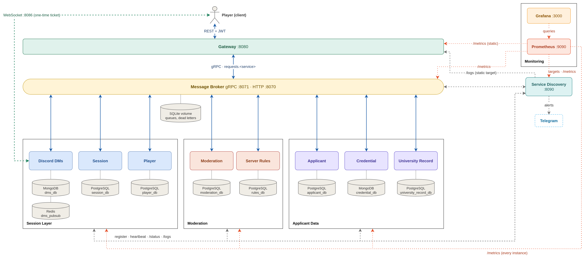

# TEAM 16's COURSE PROJECT - Student ID, please

This Common Public Repository (CPR) serves as a centralized documentation hub for the
FAF Discord Moderation game called **"Student ID, please"**

In accordance with course guidelines, each microservice source code is hosted in its
own isolated private repository accessible only to its assigned author and course professors.
This CPR contains submodules linking to those repositories and provides the global
service boundaries and communication architecture for the distributed system.

## Repo structure and Submodule Access

Due to repository permissions, cloning the CPR with submodules will only pull code for the services you personally own (or have professor-level permissions to read).

```
git clone https://github.com/DdimaPos/pad-team-16-student-id-please.git

git submodule update --init --recursive
```

## Module ownership list

- Postoronca Dumitru: `player service` and `server moderation session service`;
- Iacovlev Maxim: `applicant service` and `credential service`;
- Racovita Dumitru: `moderation service` and `discord dm service`;
- Titerez Vladislav: `server rule service` and `university-record-service`;
- Gateway (`gateway-service`): shared - the repository is owned by Iacovlev Maxim, every member contributes through PRs.
- Service Discovery (`service-discovery-service`, Lab 3): Titerez Vladislav; every member is a contributor and PRs need two approvals, as in the Gateway.
- Message Broker (`message-broker-service`, Lab 4): Titerez Vladislav; every member is a contributor and PRs need two approvals, as in the Gateway.

## Service Boundaries

The system is decomposed following a data ownership principle: for every piece of state, exactly one service is the source of truth and the only service allowed to write it. Other services may read or trigger changes only through that owning service's API. This is why applicant-related data is split into three services (Applicant, Credential, University Record) rather than one - each owns a distinct category of data (identity, documents, hidden institutional records) with a different lifecycle and different access rules, even though they describe the same real-world person.

No service calls another service, and no client calls a service, directly. A client reaches a service only through the [Gateway](#gateway); from Lab 4 the Gateway and every service reach a service only through the [Message Broker](#11-message-broker), as a request on its queue or an event on a topic (see [Communication Patterns](#communication-patterns)). Neither the Gateway nor the broker owns business state (see [9. Gateway](#9-gateway), [11. Message Broker](#11-message-broker)). The one exception, since Lab 3, is [Service Discovery](#10-service-discovery): every instance and the broker register with it directly, it polls every instance's `GET /status` and, from Lab 4, fetches every component's [`GET /logs`](#logs-download) directly, because the broker itself depends on the registry to know which instances exist.

**Note on applicant initialization:** the topic allows any of Applicant, Credential, or University Record Service to be the first to encounter a new applicant. To keep this from turning into three services writing to each other's data, we resolve it as follows: whichever service is contacted first generates a shared `applicant_id` and pushes an `ApplicantInitialized` event carrying that ID plus the fields it was given to the other two services, which create their own record under the same `applicant_id`, populated only with the fields relevant to them. Each service still only ever writes its own record - there is no cross-service write, only event-driven record creation.

**Note on applicant assignment to sessions:** the topic does not specify how a session acquires its `current_applicant_id`. We resolve this as: when the Moderator requests the next applicant, Server Moderation Session Service calls Applicant Service to generate the next applicant profile, and stores the returned `applicant_id` as `current_applicant_id` for that session.

**Note on scoped access assignment:** the topic specifies that access to University Record Service categories (enrollment, email-groups, courses, fcim-logs) is distributed among Junior Moderators within a session, but does not say who assigns it. We resolve this as: Server Moderation Session Service, which already assigns player roles when a session is formed, also assigns each Junior Moderator a subset of record categories at that same point, and passes this mapping to University Record Service so it can enforce access per `player_id` + `session_id`.

### 1. Player Service

- **Owns:** moderator player accounts - `player_id`, username, hashed credentials, email, profile, friends list, XP, level, moderation experience stats, shift history, disciplinary action log - and issues the player login token (JWT) from those credentials
- **Does NOT own:** any data about the people attempting to join the university server (that belongs entirely to the applicant-side services)
- **Interacts with:** Server Moderation Session Service, which reads a player's profile and level when they create or join a session, and reports shift results back so this service can update XP/level/disciplinary history; the client, which logs in here to obtain its token

### 2. Server Moderation Session Service

- **Owns:** the moderation session/shift itself - `session_id`, assigned Moderator, assigned Junior Moderators and the record categories each of them may read, session status, shift difficulty, `ruleset_version` used by the shift, `current_applicant_id`, number of applications processed, session score, penalties, start/end timestamps
- **Does NOT own:** applicant data, and does NOT make the admission decision - it only tracks that a decision is in progress and records the eventual outcome
- **Interacts with:** Player Service (checks players and reads their level when they create or join a session, reports shift results), Server Rules Service (gets the ruleset for the shift when it starts), Moderation Service (Moderation reads the current applicant from it before recording a decision, and reports the outcome back), Discord DMs Service (supplies session membership so it can scope its own channels), Applicant Service (requests a new applicant profile per the assignment logic above), University Record Service (assigns each Junior Moderator's record-category scope when the session is formed)

### 3. Applicant Service

- **Owns:** the applicant's core identity - `applicant_id`, name, student ID, major, year, university status (FAF student / other-major student / TA / staff / alumni / outsider), enrolled courses, role
- **Does NOT own:** credential documents (Credential Service), hidden institutional records (University Record Service), or the admission decision (Moderation Service)
- **Interacts with:** Credential Service and University Record Service via the `ApplicantInitialized` event described above; Server Moderation Session Service (supplies a new applicant profile when requested); Moderation Service (supplies the base profile for a decision)

### 4. Credential Service

- **Owns:** the documents an applicant presents - student ID card, university email, enrollment confirmation, course registration proof - along with each document's validation status (valid / expired / forged / inconsistent / incomplete)
- **Does NOT own:** the applicant's identity profile, and does NOT decide whether the applicant is admitted - it only certifies whether the documents are structurally and logically sound
- **Interacts with:** Applicant Service and University Record Service (initialization event), Moderation Service (supplies validation results, not a verdict)

### 5. Server Rules Service

- **Owns:** the current, versioned ruleset for server access, which can be edited between shifts (e.g. "first-years cannot access #dark-memes", "must be enrolled 2+ years", "banned users are rejected regardless of credentials")
- **Does NOT own:** any applicant data, and does NOT issue the final admission decision - it only answers "does this applicant satisfy the current rules?" when asked
- **Interacts with:** Server Moderation Session Service, which gets the ruleset for each new shift, and Moderation Service, which asks it to evaluate each applicant during a decision

### 6. University Record Service

- **Owns:** hidden institutional data - enrollment list, Outlook group email lists, existing course list, current academic year, semester schedule, FCIM server message records
- **Access control:** each record type is tagged by category (e.g. `enrollment`, `email-groups`, `courses`, `fcim-logs`). Within a session, each Junior Moderator is assigned a subset of categories they're permitted to query, per the scope assigned by Server Moderation Session Service; the service enforces this at the API level using `player_id` + `session_id`, and requests for a category outside a player's assignment are rejected
- **Does NOT own:** credential documents, and does NOT decide on admission, and does NOT assign the scope itself (Server Moderation Session Service does)
- **Interacts with:** Applicant Service and Credential Service (initialization event), Server Moderation Session Service (receives the per-player scope assignment when a shift starts, and closes that access when the shift ends), Moderation Service (supplies verification data, respecting the requesting player's scope)

### 7. Moderation Service

- **Owns:** the admission decision itself - `applicant_id`, decision (accept / reject / flag / ban), violated rules (if any), penalty, outcome, deciding moderator, timestamp - and the ban list built from its own `ban` decisions
- **Does NOT own:** applicant identity, documents, or institutional records - it only consumes them, read-only, to reach and record a verdict
- **Interacts with:** Applicant, Credential, and University Record Services (gathers data for the decision), Server Rules Service (checks compliance), Server Moderation Session Service (reads the current applicant and the shift's ruleset version, reports the outcome back)

### 8. Discord DMs Service

- **Owns:** real-time communication for a session - channels (e.g. `#enrollment-check`, `#faculty-check`, `#course-registration`, `#general-mod-chat`), messages (author, timestamp, channel, content), and per-player channel access mapping
- **Does NOT own:** the correctness of any information exchanged - it is a pure transport layer and never validates message content
- **Interacts with:** Server Moderation Session Service, which supplies session membership (who is in the session and their assigned roles); Discord DMs Service uses that membership data to scope its own channels and access mapping, but ownership of the channels and access mapping stays with Discord DMs Service

### 9. Gateway

- **Owns:** no data. It holds only the table of client routes (prefix => service), the credential checks and the task timeout and concurrent task limit at the entry point of the system. From Lab 4 it keeps one circuit breaker, on the Message Broker
- **Does NOT own:** any service's data, the player accounts or the issuing of tokens (Player Service), the chat connection (Discord DMs Service carries it; the Gateway only negotiates it), the instance registry (Service Discovery), or the choice of an instance (the Message Broker)
- **Interacts with:** the client, as its single point of entry; the Message Broker, to which it sends each client request as a `Request` to the owning service's queue and from which it gets the reply. See [Gateway](#gateway)

### 10. Service Discovery

- **Owns:** the instance registry (Lab 3) - which instance of which service runs where (`instance_id`, `service_name`, `host`, `port`, `version`), whether it is `up` or `down`, its last measured `load` and, from Lab 4, the `topics` it says it publishes and subscribes to
- **Does NOT own:** routing (the Message Broker decides which instance gets a message), subscriptions and queues (the broker), any business data, or any event; it produces and consumes no events
- **Interacts with:** every service and the Message Broker, whose instances register with it and send it heartbeats; every registered instance, whose `GET /status` it polls and whose `GET /logs` it fetches; the broker, which reads the `up` instances and their loads from it, marks instances `down` after a circuit breaker trip and posts one alert per dead letter; Prometheus, which reads the scrape targets from it; the developers, whom it alerts through a Telegram bot. See [Service Discovery](#service-discovery)

### 11. Message Broker

- **Owns:** delivery (Lab 4) - the topics (`events.<event_type>`), the subscriptions and the queue of each subscribed service, the request queue of every service (`requests.<service>`), the delivery state of every message (attempts, acks) and the dead letter channel; the choice of the instance that gets a message and one circuit breaker per instance
- **Does NOT own:** any business data (an event's envelope and a request's body pass through it byte for byte), the event catalog (each producer owns its events), or the instance registry (Service Discovery)
- **Interacts with:** the Gateway and every service, over gRPC: each instance holds one `Subscribe` stream and sends its `Publish`, `Ack`, `Request` and `Reply` on the same connection; Service Discovery, where it registers, reads the `up` instances and their loads, marks a tripped instance `down` and posts its dead letter alerts. See [Message Broker](#message-broker)

## Architecture Diagram



The diagram shows the system of Lab 4 as it runs when every component runs its `4.x` image. `docker-compose.yml` runs the broker, the Gateway `4.0.0` and the monitoring since #113; each service runs its `4.x` image once its own Lab 4 delivery is merged.

A client reaches the system only through the **Gateway** (REST with the player's JWT). The Gateway turns each request into a gRPC `Request` on the **Message Broker**, which puts it into the `requests.<service>` queue of the target service and hands it to one instance of that service. The eight services sit in three groups:

- **Session Layer:** Discord DMs, Server Moderation Session and Player.
- **Moderation:** Moderation Service and Server Rules Service.
- **Applicant Data:** Applicant, Credential and University Record.

Each blue line between the broker and a service is two-way and carries several kinds of traffic over one gRPC connection:

- the instance's `Subscribe` stream, which delivers the requests of its `requests.<service>` queue and the events of the `events.<event_type>` topics its service subscribed to;
- its `Reply` to a request and its `Ack` of an event;
- its own `Publish` of an event and its `Request` to another service.

No service has a line to another, because none addresses another directly: a call or an event from one service to another goes through the broker. Which service calls which, and with which rule, is listed in [Every arrow in the diagram](#every-arrow-in-the-diagram-and-the-rule-it-follows); that table shows the broker in the middle. The broker keeps its queues and dead letters in SQLite on a volume (#108). It listens for gRPC on `:8071` and serves its HTTP side on `:8070`: `/status`, `/logs`, `/metrics`, the topics listing and the dead letters.

The gray dashed lines are direct HTTP calls with **Service Discovery**:

- every instance and the broker register, heartbeat and deregister;
- Service Discovery polls their `GET /status` and fetches their `GET /logs`, and the Gateway's as a static target;
- the broker reads the instance list and the loads, marks an instance down after its breaker trips, and posts one alert per dead letter;
- Service Discovery sends its alerts to Telegram.

The red dotted lines are the monitoring of #113. Prometheus finds the instances through Service Discovery and scrapes the `/metrics` of every component, the Gateway's as a static target, and Grafana shows them. The host ports are final: `9090` for Prometheus and `3000` for Grafana (#113).

The green dashed line is the one client path that bypasses the Gateway: the chat WebSocket. The client first gets a one-time ticket and a WebSocket URL through the Gateway (see [Gateway](#gateway)), then connects to Discord DMs directly on port `8086`, so the Gateway is not kept busy carrying the chat.

Each service owns its database, drawn beneath it, and no database is shared. Player, Session, Moderation, Server Rules, Applicant and University Record use PostgreSQL, Credential uses MongoDB, and Discord DMs uses MongoDB for messages and Redis for Pub/Sub. Session keeps everything in PostgreSQL ([`docs/SERVER_MODERATION_SESSION_SERVICE.md`](docs/SERVER_MODERATION_SESSION_SERVICE.md)), so its Redis cache in [Databases](#databases) is not drawn.

---

## Technologies

### Languages

The eight services use two languages, **Go** and **C#**. The Gateway, added in Lab 2, is written in **Python** - the language the lab requires for it - and so are Service Discovery (Lab 3) and the Message Broker (Lab 4).

| #   | Service                           | Owner              | Language | Framework                 |
| --- | --------------------------------- | ------------------ | -------- | ------------------------- |
| 1   | Player Service                    | Postoronca Dumitru | Go       | Gin                       |
| 2   | Server Moderation Session Service | Postoronca Dumitru | Go       | Gin                       |
| 3   | Applicant Service                 | Iacovlev Maxim     | Go       | Gin                       |
| 4   | Credential Service                | Iacovlev Maxim     | Go       | Gin                       |
| 5   | Server Rules Service              | Titerez Vladislav  | C#       | ASP.NET Core              |
| 6   | University Record Service         | Titerez Vladislav  | C#       | ASP.NET Core              |
| 7   | Moderation Service                | Racovita Dumitru   | Go       | Gin                       |
| 8   | Discord DMs Service               | Racovita Dumitru   | Go       | Gin + `gorilla/websocket` |
| 9   | Gateway                           | whole team         | Python   | FastAPI + `httpx`         |
| 10  | Service Discovery                 | Titerez Vladislav  | Python   | FastAPI + uvicorn + `httpx` |
| 11  | Message Broker                    | Titerez Vladislav  | Python   | `grpcio` + FastAPI + uvicorn |

**Service Discovery (Lab 3) is Python 3.12**, the language the lab bans for the team, with FastAPI + uvicorn and `httpx` for the status polling and the Telegram alerts. Its registry is held in memory in its single copy, with no database: after a restart every instance is back in the registry within one heartbeat (5 s), so there is nothing worth persisting.

**The Message Broker (Lab 4) is Python 3.12** for the same reason: the lab asks for the team's banned language or one not used in a service. It reuses Service Discovery's logging, status and breaker modules. `grpc.server` with a bounded thread pool serves its gRPC API on `8071` (one thread per RPC), FastAPI + uvicorn its HTTP side on `8070` (`/status`, `/logs`, `/metrics`, the topics and dead letter listings). **The limit:** the GIL runs one Python thread at a time, so the threads give concurrency for waiting on streams and on the disk, not parallel CPU work. A broker mostly waits, so this is acceptable here; the thread arithmetic is in [`docs/MESSAGE_BROKER.md`](docs/MESSAGE_BROKER.md) §12.

**Why Go for six services.** Most of our services do the same kind of work: receive an HTTP request, call one or two other services, read or write their own database, and answer. Go is built for exactly this. It compiles to one small binary, starts in milliseconds, and goroutines make it simple to call several services at the same time (Moderation Service calls four at once). Go is also quick to learn, which matters because most of the team is picking it up during this course.

**Why C# for the rules and records services.** These two services are about data rules, not traffic. Server Rules answers "does this applicant satisfy rule version 7?" and University Record answers "may this player read the enrollment list?". C# has a strong type system and pattern matching that make such rules explicit in code, and ASP.NET Core has built-in policy-based authorization that expresses "player X may read category Y" directly. Their owner has the most C# experience in the team.

**Trade-off.** Two languages mean two toolchains, two sets of libraries and two ways to write a Dockerfile. We accept that because every service exposes the same interface - REST + JSON to the client, and from Lab 4 the same gRPC contract with the broker, generated from one [`shared/broker.proto`](shared/broker.proto) - so a Go service and a C# service talk to each other in exactly the same way.

### Frameworks and libraries

| Purpose     | Go                                     | C#                    |
| ----------- | -------------------------------------- | --------------------- |
| HTTP server | Gin                                    | ASP.NET Core Web API  |
| HTTP client | `net/http`                             | `HttpClient`          |
| gRPC (Lab 4, the broker client) | `google.golang.org/grpc` | generated from `Protos/broker.proto` |
| WebSocket   | `gorilla/websocket` (Discord DMs only) | not needed            |
| PostgreSQL  | `pgx`                                  | Npgsql + EF Core      |
| MongoDB     | `mongo-go-driver`                      | `MongoDB.Driver`      |
| Redis       | `go-redis`                             | `StackExchange.Redis` |

Every service runs in its own Docker container. From Lab 4 services reach each other only through the Message Broker (see [Communication Patterns](#communication-patterns)).

### Databases

**Rule: every service has its own database, and no service ever connects to another service's database.** Why this rule exists is explained in Communication Contract, Data Management.

We use three engines. PostgreSQL is the default. MongoDB and Redis are used only where there is a concrete reason.

| Service                   | Database                      | Engine            | Why this engine                                                                                                                                                                                                                                            |
| ------------------------- | ----------------------------- | ----------------- | ---------------------------------------------------------------------------------------------------------------------------------------------------------------------------------------------------------------------------------------------------------- |
| Player                    | `player_db`                   | PostgreSQL        | Accounts, XP, shift history and the disciplinary log are tables with relations between them. When a shift ends, XP and history must update together, which needs a transaction.                                                                            |
| Server Moderation Session | `session_db`, `session_cache` | PostgreSQL, Redis | History of shifts (who, when, score) goes to PostgreSQL. The state of the shift running right now (current applicant, counters) goes to Redis because it is read on every action and must be fast.                                                         |
| Applicant                 | `applicant_db`                | PostgreSQL        | Every applicant has the same fields (name, student ID, major, year, status, courses). A fixed structure is a table.                                                                                                                                        |
| Credential                | `credential_db`               | MongoDB           | Each applicant has a bundle of documents, and every document type has different fields. In a table this would be many empty columns. A document store keeps each bundle as one JSON document.                                                              |
| Server Rules              | `rules_db`                    | PostgreSQL        | Rulesets are versioned, and each shift records which version it used, so versions must be queryable. Rule conditions are stored as JSONB so a new rule type does not need a schema change.                                                                 |
| University Record         | `university_record_db`        | PostgreSQL        | Enrollment lists, email groups, courses and schedules are tables. Access control is a join between "records by category" and "which player may see which category in this session".                                                                        |
| Moderation                | `moderation_db`               | PostgreSQL        | Each decision is an audit record: who decided, what, whether it was correct, which rules were broken. Queried by session, moderator and applicant. Never changed after it is written.                                                                      |
| Discord DMs               | `dms_db`, `dms_pubsub`        | MongoDB, Redis    | Messages are appended and read back per channel in time order, which is what a Mongo collection with an index does. Redis Pub/Sub is not storage: it passes each new message to every running instance of the service so all connected players receive it. |
| Service Discovery         | none                          | in memory         | The registry is rebuilt by the heartbeats within 5 s of a restart, and Service Discovery runs as one copy, so a database would add a dependency without keeping anything that matters.                                                                     |
| Message Broker            | `/data/broker.db`             | SQLite (WAL)      | Messages, subscriptions and dead letters must survive a restart, but only the broker's one copy reads them. An embedded file on a named volume needs no server; a publish is on disk (`synchronous=FULL`) before it is answered. |

---

## Communication Patterns

A client sends every request to the **Gateway** over REST (`{gateway}/api/v1/<service>/...`, see [Gateway](#gateway)). From Lab 4 everything behind the Gateway travels through the **Message Broker** over gRPC: the Gateway hands a client's request to the broker, and a service calling another service, or announcing an event, talks only to the broker (see [Message Broker](#message-broker)). A caller never addresses a service or an instance directly (the exceptions are the calls of [Service Discovery](#service-discovery)). On that common path, components talk in three ways. Each way has one rule for when to use it.

### Rule 1. You need an answer right now: a request (REST at the Gateway, gRPC through the broker)

Example: Session Service needs the next applicant before it can continue. It sends the broker a `Request` for `applicant`, `POST /api/v1/applicants/next`; the broker puts it into the `requests.applicant` queue, delivers it to one Applicant instance on that instance's `Subscribe` stream, and hands that instance's `Reply` back to Session, which waits for it. A client's request takes the same path behind the Gateway: the client calls `POST {gateway}/api/v1/session/sessions/{id}/applicants/next` over REST, and the Gateway sends it to `requests.session` the same way.

A request carries the method, path, headers and JSON body of the endpoint listed under [Endpoints](#endpoints), and the reply its status, headers and body, so every endpoint keeps its contract; only the transport between the components changed. The client keeps REST + JSON because it is easy to read and to test with curl or Postman. Between the components gRPC gives one typed contract for three languages ([`shared/broker.proto`](shared/broker.proto)) and a long-lived stream per instance, so the broker never has to dial a service: an instance that drops its stream is gone.

### Rule 2. Something happened and others should know, no reply needed: an event, published to a topic

Example: a shift ends. Session Service publishes one event, `session.ended`, to the topic `events.session.ended`. Player, Discord DMs and University Record are subscribed to it, so the broker puts a copy into each one's queue. Player Service updates XP, Discord DMs archives the channels. Closing the shift does not wait for any of them.

The producer writes the event to its own outbox table in the same database transaction as the change it announces, and a background relay publishes it once to `events.<event_type>`, retrying until the broker has stored it. The producer names a topic, never a consumer: who receives it is decided by who subscribed. Each consumer acks a copy only after it applied it, and the broker delivers it again until it does, so an event may arrive twice; every consumer remembers the `event_id` values it has seen and ignores repeats. This is what makes events safe: if Player Service is down for a minute, the event waits in its queue on the broker and XP is still awarded exactly once. The full delivery rules are under [Event delivery](#event-delivery).

### Rule 3. The client must be pushed to: WebSocket (Discord DMs only)

Players chat in channels and must see new messages instantly. Discord DMs Service keeps one WebSocket connection open per player. No other service holds client connections. The connection is **negotiated through the Gateway but not carried by it**: the client asks the Gateway for a connection, gets back a WebSocket URL with a one-time ticket, and connects to Discord DMs Service directly, so the Gateway is not kept busy in the middle of every chat (see [`POST /api/v1/ws-tickets`](#post-apiv1ws-tickets---consumed-by-client)). Channel lists and message history are also available over REST, through the Gateway, so a client that reconnects can catch up.

### Every arrow in the diagram and the rule it follows

"`A => GW => MB => B`" means A calls the Gateway over REST, which sends the request through the Message Broker to one instance of B; "`A => MB => B`" is a request from a service through the broker; "`A -> events.x -> B`" is an event A publishes to the topic `events.x`, delivered to B's queue. Paths are the service's own paths; through the Gateway they carry the service prefix (`/api/v1/player/...`).

| Interaction                                                             | Rule                                        | Who calls whom                                                       | Why this rule                                                                                              |
| ----------------------------------------------------------------------- | ------------------------------------------- | -------------------------------------------------------------------- | ---------------------------------------------------------------------------------------------------------- |
| Player logs in                                                          | Request `POST /auth/login`                  | client => GW => MB => Player                                         | The client needs a token before anything else                                                              |
| Player creates or joins a session                                       | Request                                     | client => GW => MB => Session; Session => MB => Player `GET /players/{id}` | Needs an answer now                                                                                  |
| Session reports shift results                                           | Event `session.ended`                       | Session -> `events.session.ended` -> Player, University Record       | Player updates XP later; closing the shift must not wait for it                                            |
| Session picks the ruleset for a new shift                               | Request `GET /rulesets/current`             | Session => MB => Server Rules                                        | The shift cannot start without knowing its `ruleset_version`                                               |
| Session requests the next applicant                                     | Request `POST /applicants/next`             | Session => MB => Applicant                                           | Needs the `applicant_id` now                                                                               |
| Applicant is initialized (`ApplicantInitialized` in Service Boundaries) | Event `applicant.initialized`               | the service contacted first -> `events.applicant.initialized` -> the other two | Two listeners, no waiting, no cross-service writes                                               |
| Session assigns record scopes to Junior Moderators                      | Event `session.started`                     | Session -> `events.session.started` -> University Record             | Membership and scopes travel together in one event                                                         |
| Session supplies channel membership                                     | Events `session.started`, `session.ended`   | Session -> `events.session.started`, `events.session.ended` -> Discord DMs | Discord DMs creates and archives channels on its own                                                 |
| Moderator submits a decision                                            | Request `POST /decisions`                   | client => GW => MB => Moderation                                     | The verdict must come back now                                                                             |
| Session supplies the current applicant                                  | Request `GET /sessions/{id}`                | Moderation => MB => Session                                          | Moderation checks that the decision is about the current applicant and reads the shift's `ruleset_version` |
| Moderation gathers data for the verdict                                 | Requests, three in parallel                 | Moderation => MB => Applicant, Credential, University Record         | All three answers are needed to know what is true about the applicant                                      |
| Moderation checks the rules                                             | Request `POST /rulesets/{version}/evaluations` | Moderation => MB => Server Rules                                  | Needs the verified facts from the three calls above, so it comes after them                                |
| Moderation reports the outcome                                          | Event `decision.recorded`                   | Moderation -> `events.decision.recorded` -> Session                  | Session updates score and counters; no reply needed                                                        |
| A player opens the chat                                                 | Request `POST /ws-tickets`, then WebSocket  | client => GW => MB => Discord DMs (ticket); client ↔ Discord DMs (socket) | The Gateway authorizes the connection but does not carry it                                           |
| Players chat during a shift                                             | WebSocket (requests for history)            | client ↔ Discord DMs; history client => GW => MB => Discord DMs      | Push in real time                                                                                          |
| An instance takes its requests and events (Lab 4)                       | gRPC `Subscribe` stream                     | every instance of the eight services => MB                           | The broker never dials a service; the stream carries its requests and events, and the instance answers on the same connection |
| An instance registers and sends heartbeats (Lab 3)                      | REST `PUT /instances/{instance_id}`         | every instance of the eight services and the broker => Service Discovery directly | The broker needs the registry to route, so registration cannot go through it                |
| An instance shuts down gracefully (Lab 3)                               | REST `DELETE /instances/{instance_id}`      | the instance => Service Discovery directly                           | Removes it from the registry at once instead of after the 15 s TTL                                         |
| Service Discovery checks health and load (Lab 3)                        | REST `GET /status`                          | Service Discovery => every registered instance directly              | One specific instance is checked, which a queue cannot address                                             |
| Service Discovery fetches the logs of the whole system (Lab 4)          | REST `GET /logs`                            | Service Discovery => every `up` instance, the broker and the Gateway directly | One specific instance is read, and `GET /logs` checks the service token itself                    |
| The broker reads the instances and their loads (Lab 4)                  | REST `GET /instances`                       | MB => Service Discovery                                              | Routes each message to the least loaded `up` instance, every 5 s                                           |
| The broker removes an instance after a breaker trip (Lab 4)             | REST `PUT /instances/{instance_id}/status`  | MB => Service Discovery                                              | Other readers of the registry stop seeing the failing instance                                             |
| The broker reports a dead letter (Lab 4)                                | REST `POST /alerts`                         | MB => Service Discovery                                              | One alert hook, one Telegram bot and one cooldown for the whole system                                     |
| Prometheus finds and scrapes every component (Lab 4)                    | REST `GET /instances/prometheus`, `GET /metrics` | Prometheus => Service Discovery; Prometheus => every component directly | The metrics of one specific instance; see [Monitoring](#monitoring)                         |
| Service Discovery alerts the developers (Lab 3)                         | Telegram Bot API `sendMessage`              | Service Discovery => Telegram                                        | Critical load, an unreachable or removed instance, a recovery, a dead letter                               |

### Worked example: one applicant from start to finish

Every client request below passes through the Gateway, which checks the caller's credential (see [Authentication](#authentication)), and every request and event between the components through the Message Broker.

0. Each player logs in through Player Service and receives a JWT; the client sends it with every request.
1. The Moderator asks for the next applicant. Session sends a request to Applicant through the broker. Applicant Service creates the applicant and publishes `applicant.initialized`; Credential and University Record receive it from their queues and create their own records under the same `applicant_id`.
2. Junior Moderators look up records. The client calls University Record through the Gateway. Each player only sees the categories assigned to them in `session.started`.
3. The team discusses in channels: each client obtains a ticket through the Gateway and holds a WebSocket open directly to Discord DMs.
4. The Moderator submits a decision with `POST /api/v1/decisions`. Moderation Service asks Session (is this the current applicant, and which ruleset does the shift use?), then Applicant, Credential and University Record in parallel. From the records it builds the verified facts and sends them to Server Rules. All of these are requests through the broker. It computes the correct verdict, compares it with the Moderator's choice, stores the decision and replies.
5. Moderation publishes `decision.recorded`; Session receives it, updates the score and counters.
6. The shift ends. Session publishes `session.ended`; Player, Discord DMs and University Record each receive a copy. Player updates XP and history; Discord DMs archives the channels; University Record closes the juniors' access.

**Note on University Record access.** A player's request is limited to the categories assigned to that player in the session. Moderation Service needs all categories to compute the correct verdict, so it calls University Record's service-only endpoint through the broker, which authenticated Moderation by its service token (see [Through the Message Broker](#through-the-message-broker-lab-4)). University Record recognises the service call by the route and by the absence of `X-Player-Id`; the Gateway does not serve that route at all (see [Gateway](#gateway)). The token never reaches a client.

---

## Communication Contract

### Data Management

**Rule: one database per service, and only the owning service writes to it.** If a service needs data it does not own, it either calls the owner's API (from Lab 4 a request through the broker) or listens to the owner's events. It never reads another service's tables.

Why:

- Service Boundaries say each piece of data has exactly one writer. With a shared database that is a promise; with separate databases it is enforced.
- Services must be deployable and scalable one by one in later laboratories. A shared schema ties every deploy to every other service.
- The data has different shapes: relational decisions and rules, document-shaped credentials and messages, cached shift state. One engine does not fit all of them well.

What it costs, and what we do about it:

- **Data that crosses a boundary through events arrives a little later.** Credential Service learns about a new applicant a few milliseconds after Applicant Service creates it. Consumers are idempotent and keyed by the shared identifier, so order and repeats do not matter.
- **No transaction can span two services.** A flow like "decision => session score => player XP" is a chain of events, not one transaction. Compensation for failures is a topic for the transactions laboratory.
- **No joins across services.** A service that needs a combined view asks each owner and combines the answers itself. Moderation Service does exactly this.

**Permitted duplication.** A service may keep a read-only copy of another service's data if it needs it for auditing or speed, as long as the owner stays the source of truth. Moderation Service stores a snapshot of the applicant, credentials and rule version behind each verdict, so the decision can still be explained after the applicant or the rules have changed.

**Shared identifiers.** `player_id`, `session_id`, `applicant_id`, `decision_id`, `channel_id` and `message_id` are UUID v4 strings. `ruleset_version` is an integer that grows by one with every new ruleset - within one deployment: wiping Server Rules Service's database resets the counter to 1, which silently invalidates any `ruleset_version` a peer (Moderation Service) has snapshotted from before the reset. Do not drop that volume between demos. `applicant_id` is generated by whichever service initializes the applicant and is the same in Applicant, Credential and University Record.

#### Event catalog

Every event has the same envelope; only `payload` differs.

```json
{
  "event_id": "4f0c2a8e-1c3b-4d0e-9a6f-2b7e8c9d1a23",
  "event_type": "session.started",
  "occurred_at": "2026-09-09T14:32:10Z",
  "producer": "server-moderation-session-service",
  "version": 1,
  "payload": {}
}
```

| `event_type`            | Produced by                                                           | Delivered to                           | Payload (key fields)                                                                                                                        |
| ----------------------- | --------------------------------------------------------------------- | -------------------------------------- | ------------------------------------------------------------------------------------------------------------------------------------------- |
| `applicant.initialized` | the first of Applicant, Credential, University Record to be contacted | the other two                          | `applicant_id`, `session_id`, `initialized_by`, `difficulty`, `claimed`, `actual` (each an [applicant profile](#shared-values) itself, not an object with a `profile` key)                                   |
| `session.started`       | Server Moderation Session                                             | University Record, Discord DMs         | `session_id`, `moderator_id`, `junior_moderators[] { player_id, record_scopes[] }`, `ruleset_version`, `started_at`                         |
| `session.ended`         | Server Moderation Session                                             | Player, Discord DMs, University Record | `session_id`, `score`, `penalties`, `applications_processed`, `players[] { player_id, role, xp_delta, disciplinary_actions[] }`, `ended_at` |
| `decision.recorded`     | Moderation                                                            | Server Moderation Session              | `decision_id`, `session_id`, `applicant_id`, `moderator_id`, `action`, `is_correct`, `expected_action`, `violated_rules[]`, `penalty`       |

`role` in `session.ended` is `moderator` or `junior_moderator`. A consumer that does not need it ignores it.

From Lab 4 each event is published to the topic `events.<event_type>` and delivered to the services subscribed to it, which are the ones in "Delivered to" (see [Event delivery](#event-delivery)).

#### Event delivery

From Lab 4 events travel from the producer to each consumer through the [Message Broker](#message-broker): the producer publishes once to a topic, and the broker keeps one queue per subscribed service. Nothing is pushed over HTTP any more; `POST /api/v1/events` is gone from every service (#105).

**Names.**

| Name | Example | What |
| --- | --- | --- |
| Topic | `events.session.started` | `events.<event_type>`, one per event type in the catalog above. A producer names a topic, never a consumer |
| Topic queue | `events.session.started.discord-dms` | `<topic>.<service>`, one per subscribed service, shared by all its instances (competing consumers) |

A topic matches `events(\.[a-z][a-z0-9_]*)+` and a service `[a-z][a-z0-9-]*`, each at most 200 characters. A message reaches each subscribed service once, whatever the number of its instances, and one instance of it; each queue's copy has its own `message_id`.

**Subscriptions.** An instance names its service and the topics it consumes in its `Subscribe` call (see [Message Broker](#message-broker)); that call is the source of truth. The `topics` an instance sends in its registration with [Service Discovery](#service-discovery) only document the same intent. A subscription belongs to the service, not the instance: its queue outlives the instances and a broker restart and collects messages while none of them is connected, and a topic with no subscriber yet keeps the message for every service that subscribes later (until `MESSAGE_RETENTION_HOURS`).

| Topic | Published by | Subscribed by |
| --- | --- | --- |
| `events.applicant.initialized` | Applicant, Credential, University Record | Applicant, Credential, University Record (each ignores the events it produced itself) |
| `events.session.started` | Session | University Record, Discord DMs |
| `events.session.ended` | Session | Player, Discord DMs, University Record |
| `events.decision.recorded` | Moderation | Session |

Moderation and Server Rules subscribe to no topic; they take only requests.

**Producer side.**

1. The event is written to the producer's own outbox table **in the same database transaction** as the state change it announces, so an event never exists without its change, nor the reverse.
2. A background relay publishes the envelope, unchanged, **once** to `events.<event_type>` with `Publish` (`topic`, `event_id`, `event_type`, `producer`, `version`, `envelope_json`, `request_id`; see [`shared/broker.proto`](shared/broker.proto)).
3. `Publish` answers only once the message is on the broker's disk and in every subscribed service's queue (or kept). Then the relay marks the event delivered. Any gRPC error (`UNAVAILABLE`, `RESOURCE_EXHAUSTED` for a full queue, a deadline) leaves it pending, and the relay retries with backoff (capped at 30 s). A producer no longer tracks its consumers: the broker does, per queue.

**Consumer side - a `Delivery` with an `event` on the instance's stream.** The consumer answers it with `Ack(message_id, outcome)`:

| Outcome | When | The broker does |
| --- | --- | --- |
| `OK` | The event was applied, or it is a repeat of an `event_id` already applied | Removes the copy from the queue |
| `RETRY` | A failure that may succeed later (its own database is down) | Delivers it again after `MESSAGE_RETRY_DELAY_SECONDS` (`5`), to another instance when there is one; a failed attempt |
| `PERMANENT` | It can never succeed: the envelope cannot be parsed, its `event_type` is not one this service consumes, its `version` is unknown, its payload fails validation (the old `422 INVALID_EVENT`) | Moves it to the dead letter channel at once |
| no `Ack` within `MESSAGE_ACK_TIMEOUT_SECONDS` (`5`, the services' task timeout), or the instance's stream ends | | Delivers it again, to another instance when one is connected; a failed attempt |

- The consumer records the `event_id` **in the same transaction** as the change the event causes, and acks `OK` only after that transaction commits.
- An instance holds at most its `max_concurrent_tasks` unanswered messages; the others wait in the queue. Among the connected instances the broker picks the least loaded one (see [Load balancing](#load-balancing)).
- **Dead letters.** After `MESSAGE_MAX_ATTEMPTS` (`3`) failed attempts, or at once on `PERMANENT`, the copy goes to the broker's dead letter channel (`GET /api/v1/dead-letters` on the broker, read-only), is logged `broker.dead_lettered` and raises one `dead_letter` alert through Service Discovery to the developers. A dead letter stays until a person deals with it; it is never delivered again on its own.

**Guarantees.** Delivery is at-least-once: a copy acked late, or acked by an instance that crashed before the ack arrived, is delivered again. There is **no ordering guarantee** between events, even from one producer: a consumer must cope, for example, with `session.ended` arriving before `session.started`. Messages, subscriptions and dead letters are durable on the broker's volume (see [Message Broker](#message-broker)).

**Versions.** `version` in the envelope is bumped by one for a breaking payload change of that event. Consumers reject a version they do not know with `PERMANENT`.

> **Known gap (Credential).** Credential Service `4.0.0` dedups `applicant.initialized` by `applicant_id`, not by
> `event_id` (see [`docs/CREDENTIAL_SERVICE.md`](docs/CREDENTIAL_SERVICE.md)). The effect is the same for that one
> event, which creates one record per applicant, but the rule above stays `event_id`.

#### Gateway

The Gateway is the single entry point of the system for clients (Lab 2). From Lab 4 it serves **only the client routes** below and sends each request through the [Message Broker](#message-broker); services never call it, and it calls no service directly. It owns no data and produces no events. Its own reference is [`docs/GATEWAY.md`](docs/GATEWAY.md).

**Address.** Container `gateway-service`, port `8080` inside `student-id-net` (`http://gateway-service:8080`), published on host port `8080`. It reaches the broker at `MESSAGE_BROKER_URL` (`message-broker-service:8071`).

**Route scheme.** `{gateway}/api/v1/<prefix>/<rest>` is sent to the service behind `<prefix>` as `/api/v1/<rest>` - the prefix segment is removed, so every service keeps the paths documented under [Endpoints](#endpoints). Example: `GET {gateway}/api/v1/server-rules/rulesets/7` reaches `GET /api/v1/rulesets/7` of one `server-rules` instance. The prefix also tells apart paths that exist in several services (`GET /applicants/{id}`, `/health`).

The prefix is also the service's name everywhere else: the broker's request queue `requests.<prefix>`, `service_name` at registration with Service Discovery, the first part of `instance_id`, `service` in `GET /status` and in every log line.

| Prefix              | Service                           | REST port of its instances (Lab 2 address) |
| ------------------- | --------------------------------- | --------------------------------------- |
| `player`            | Player Service                    | `8080` (`http://player-service:8080`)            |
| `session`           | Server Moderation Session Service | `8080` (`http://session-service:8080`)           |
| `applicant`         | Applicant Service                 | `8081` (`http://applicant-service:8081`)         |
| `credential`        | Credential Service                | `8082` (`http://credential-service:8082`)        |
| `server-rules`      | Server Rules Service              | `8080` (`http://server-rules-service:8080`)      |
| `university-record` | University Record Service         | `8080` (`http://university-record-service:8080`) |
| `moderation`        | Moderation Service                | `8085` (`http://moderation-service:8085`)        |
| `discord-dms`       | Discord DMs Service               | `8096` (`http://discord-dms-service:8096`, REST; `8086` is its WebSocket listener) |

The REST port is where Service Discovery polls `GET /status` and fetches `GET /logs`; the Gateway does not use it from Lab 4.

**Client routes (Lab 4, #110).** The whole route table. Every route needs a player token, except the public ones marked.

| Prefix | Routes |
| --- | --- |
| every prefix | `GET /health` (public) |
| `player` | `POST /auth/login` (public), `POST /players` (public, registration), `GET /players`, `GET`/`PATCH`/`DELETE /players/{player_id}`, `GET /players/{player_id}/profile`, `GET /players/{player_id}/shifts`, `GET /players/{player_id}/disciplinary-actions`, `GET`/`POST /players/{player_id}/friends`, `DELETE /players/{player_id}/friends/{friend_id}` |
| `session` | `GET`/`POST /sessions`, `GET`/`DELETE /sessions/{session_id}`, `POST /sessions/{session_id}/players`, `DELETE /sessions/{session_id}/players/{player_id}`, `POST /sessions/{session_id}/start`, `POST /sessions/{session_id}/applicants/next`, `POST /sessions/{session_id}/end`, `GET /sessions/{session_id}/decisions`, `GET /sessions/{session_id}/events` |
| `applicant` | `GET /applicants/{applicant_id}` |
| `credential` | `GET /applicants/{applicant_id}/documents` |
| `university-record` | `GET /records/{category}` |
| `server-rules` | `GET /rulesets/{version}` (`version` digits only) |
| `moderation` | `GET`/`POST /decisions`, `GET /decisions/{decision_id}`, `GET /bans` |
| `discord-dms` | `POST /ws-tickets`, `GET /sessions/{session_id}/channels`, `GET`/`POST /channels/{channel_id}/messages`, `PATCH /channels/{channel_id}/messages/{message_id}` |

**Every other path answers `404 NOT_FOUND`**, before any credential is checked, and nothing is sent to the broker: `POST /events`, `/admin/*`, `/dev/*`, `/health/ready`, `/logs`, `/metrics` and every service-to-service route (`POST /applicants/next` of Applicant, Credential and University Record, `GET /applicants/{id}/documents/validation`, `GET /applicants/{id}/records`, `GET /rulesets/current`, `POST /rulesets/{version}/evaluations`, Applicant's and Credential's CRUD extensions, Session's `/deliveries`). A known path with a method it does not take is `404` too. The services keep those handlers for each other, reached through the broker. A path is matched as the service will read it: percent-decoded, case-insensitive, repeated and trailing slashes collapsed.

**Sending a request.** Each request on a client route is one `Request` to the broker (see [Message Broker](#message-broker)): `service` (the prefix), a new `correlation_id`, the method, the service's path with the query string, the body, `request_id`, `caller: "gateway"`, `timeout_ms`, and three headers: `X-Request-ID`, `X-Player-Id` (set from the checked player token, never the caller's own) and the caller's `Content-Type`. No other header of the caller is sent. The broker puts it into `requests.<prefix>`, hands it to one instance and returns that instance's `Reply`; its status, headers and body reach the caller unchanged. `timeout_ms` is what is left of the Gateway's `10s` task timeout once the body has arrived, less a tenth (at most 250 ms), so the broker's own `408` comes before the Gateway gives up.

**What the Gateway answers itself**, always in the shared error envelope:

| Situation                                                    | Answer                                                |
| ------------------------------------------------------------ | ----------------------------------------------------- |
| Unknown prefix, or not a client route                        | `404 NOT_FOUND`                                       |
| Missing or unusable player token                             | `401` - see [Authentication](#authentication)         |
| The task ran past the Gateway's timeout (`10s`), the broker's deadline included | `408 REQUEST_TIMEOUT`              |
| The Gateway's own concurrent task limit is reached           | `429 TOO_MANY_REQUESTS`                               |
| The broker is unreachable, or the Gateway's breaker on the broker is open | `503 SERVICE_UNAVAILABLE`, `details.service: "message-broker"` |

What the broker answers itself passes through unchanged, in the same envelope: `503 SERVICE_UNAVAILABLE` with `details.service` naming the prefix (no instance of the service, or every one skipped by its breaker), `408 REQUEST_TIMEOUT` (no reply in time) and `429 TOO_MANY_REQUESTS` (the broker's workers are taken). Callers treat `408`, `429` and `503` as "may be retried", except for the non-idempotent `POST`s listed under [API conventions](#api-conventions).

**No retries.** The Gateway sends a request once. It never retries on its own, so a non-idempotent call such as `POST /decisions` is never duplicated by it.

**One circuit breaker, on the broker.** The Gateway keeps one [circuit breaker](#circuit-breaker), on the broker, its only target, with a 35 s window (its task timeout `10s` x 3.5). A failure is a call that failed in transport (`UNAVAILABLE`, `DEADLINE_EXCEEDED`, ...); a reply of any status is not, because the instances' breakers are the broker's. The Gateway no longer reads Service Discovery and never names an instance.

#### Message Broker

The Message Broker (Lab 4) carries every request and every event between the components: the Gateway's requests on behalf of clients, the requests one service makes to another, and every event. It owns topics, queues, subscriptions and delivery state, and no business data. Its own reference is [`docs/MESSAGE_BROKER.md`](docs/MESSAGE_BROKER.md).

**Address.** Container `message-broker-service`, one copy. gRPC on `8071` (plaintext HTTP/2 inside `student-id-net`): every service and the Gateway set `MESSAGE_BROKER_URL=message-broker-service:8071`, a `host:port` without a scheme. HTTP on `8070` (`http://message-broker-service:8070`): `GET /health`, `GET /status`, `GET /logs`, `GET /metrics`, and with the service token `GET /api/v1/topics` and `GET /api/v1/dead-letters`. It registers with Service Discovery as `message-broker`, which is also its `service` in `/status` and in its log lines.

**The gRPC contract is [`shared/broker.proto`](shared/broker.proto)** (package `broker.v1`), the one file every client is generated from. Each component keeps a byte-identical copy in its own repository, because a submodule build cannot reach the CPR; a change is made here first. Every call carries the metadata `x-service-token: <SERVICE_TOKEN>` (see [Through the Message Broker](#through-the-message-broker-lab-4)): missing is `UNAUTHENTICATED`, wrong is `PERMISSION_DENIED`.

| RPC | Who calls it | What |
| --- | --- | --- |
| `Subscribe(service, instance_id, topics, max_concurrent_tasks)` | every instance of the eight services | One server stream per instance, for as long as it is connected: the requests of `requests.<service>` (attached automatically) and the events of each topic in `topics`. At most `max_concurrent_tasks` (at least 1) unanswered deliveries at a time. A second stream with the same `instance_id` ends the first |
| `Publish(topic, event_id, event_type, producer, version, envelope_json, request_id)` | a producer's outbox relay | `topic` is `events.<event_type>`. Answers once the message is on disk and in every subscribed service's queue (see [Event delivery](#event-delivery)) |
| `Ack(message_id, instance_id, outcome, reason)` | a consumer | `OK`, `RETRY` or `PERMANENT` for an event delivery. Idempotent. Never settles a request |
| `Request(service, correlation_id, method, path, headers, body, request_id, caller, timeout_ms)` | the Gateway; a service calling another | Blocks until one instance of `service` replies, the timeout passes or no instance can take it |
| `Reply(reply, message_id)` | the instance that got a request | Its `status`, `headers` and `body`, passed to the caller unchanged |
| `ListTopics()`, `ListDeadLetters(limit, offset)` | developers, tools | The same listings as the HTTP side |

**Request and reply.** A request is put into `requests.<service>`, delivered to one instance as `Delivery.request`, and answered with `Reply`. It is never stored, never acked and never sent twice blindly, since a non-`GET` may already have run. Its headers pass through except `X-Service-Token` and `Authorization`, which never leave the broker. What the broker answers itself is a normal `ServiceReply` in the shared error envelope, never a gRPC error:

| What happened | `ServiceReply` |
| --- | --- |
| The instance replied | its status, headers and body, unchanged |
| No instance of the service is subscribed, or every one is skipped by its open breaker | `503 SERVICE_UNAVAILABLE`, `details.service`, at once |
| The broker's workers for waiting calls are taken | `429 TOO_MANY_REQUESTS` with `Retry-After`, at once |
| No reply within the timeout | `408 REQUEST_TIMEOUT` |
| The instance holding it was lost (stream ended, breaker tripped) | a `GET` is sent to another instance within the remaining timeout; any other method `503` at once |

- **Timeout.** The request's `timeout_ms`; `MESSAGE_REQUEST_TIMEOUT_SECONDS` (`10`, the Gateway's task timeout) when it is 0; at most `MESSAGE_REQUEST_MAX_TIMEOUT_SECONDS` (`60`). The instance gets that timeout less a tenth (at most 250 ms), so its own `408` arrives first. A service calling another sends its own outgoing-call timeout (Session `3s`, Moderation `4s`), below its `5s` task timeout.
- **A service that called another** treats the broker's `503`, `408` and `429` like any other failure of a peer: `500 DEPENDENCY_UNAVAILABLE` (see [Errors](#errors)).
- **No `504`.** A request without a reply in time is `408 REQUEST_TIMEOUT` everywhere, the same code as a task timeout.

**Delivery of events**, acks, redelivery and the dead letter channel: see [Event delivery](#event-delivery). **Which instance gets a message:** see [Load balancing](#load-balancing). **Its breakers:** see [Circuit breaker](#circuit-breaker).

**Durability.** Messages, subscriptions and dead letters live in SQLite (WAL) at `MESSAGE_STORE_PATH` (`/data/broker.db`) on a named volume, committed before the call that changed them returns. After a restart the broker rebuilds its queues before it takes a call, and the instances reconnect on their own: an acked copy is never delivered again, one delivered but not acked goes out again. An acked copy is deleted after `MESSAGE_RETENTION_HOURS` (`24`). Above `MESSAGE_QUEUE_MAX_DEPTH` (`10000`) messages in a queue or `MESSAGE_MAX_TOPICS` (`1000`) topics a publish is refused (`RESOURCE_EXHAUSTED`) and changes nothing, so the producer's outbox retries. When the disk cannot be written, `Publish`, `Subscribe` and `Ack` answer `UNAVAILABLE` and `GET /status` answers `503 degraded`.

**Threads.** One thread per RPC from a bounded pool (`GRPC_MAX_WORKERS`, `64`): a stream holds one for its whole life, a `Request` until its reply. `GRPC_RESERVED_WORKERS` (`16`) are kept for `Reply`, `Ack` and `Publish`, so a burst of waiting requests never starves the answers. One more RPC than the pool is `RESOURCE_EXHAUSTED`.

#### Service Discovery

Service Discovery (Lab 3) keeps the registry of running instances: which instance of which service runs where, and whether it is `up` or `down`. From Lab 4 the Message Broker routes from it and registers with it, like every service instance; Prometheus reads its scrape targets from it. It owns no business data and takes part in no event. Its own reference is [`docs/SERVICE_DISCOVERY.md`](docs/SERVICE_DISCOVERY.md).

**Address.** Container `service-discovery-service`, port `8090` inside `student-id-net` (`http://service-discovery-service:8090`), published on host port `8090`. Every service and the broker find it through `SERVICE_DISCOVERY_URL`; an empty value disables registration (one warning line at startup), for local runs and tests.

**Two exceptions to the rules above**, both because the broker itself depends on the registry:

- Registration, heartbeats, deregistration, the status polling and the [logs download](#logs-download) (Lab 4) go **directly** between an instance and Service Discovery, not through the Gateway or the broker.
- Service Discovery **checks `X-Service-Token` itself** on every `/api/v1` endpoint (`401 INVALID_SERVICE_TOKEN` for a wrong token, `403 SERVICE_TOKEN_REQUIRED` for none), like the broker on its own; from Lab 4 every component also checks it on its own [`GET /logs`](#logs-download). `GET /health` and `GET /status` need none.

**Instance identity.**

- `service_name` is the Gateway prefix: `player`, `session`, `applicant`, `credential`, `server-rules`, `university-record`, `moderation`, `discord-dms`, and from Lab 4 `message-broker` for the broker. Any other value is `400 VALIDATION_ERROR`.
- `instance_id` is `<service_name>-<hostname>` (letters, digits, `.`, `_`, `-`, at most 200 characters), the hostname read from the OS (`os.Hostname()`, `Dns.GetHostName()`, `socket.gethostname()`), which in Docker is the container id prefix: `player-3f4e2a9b1c7d`. A restarted container keeps its id, so an instance marked `down` stays `down` until health polling recovers it. An optional `INSTANCE_ID` variable overrides it for runs outside Docker.
- `host` is the source IP of the registration or heartbeat request, unless the body carries `host` (set from the optional `INSTANCE_HOST` variable, for a service running outside Docker). A heartbeat from a new IP updates it.
- `port` is the REST port, where Service Discovery polls `GET /status` (Discord DMs: `8096`, not its WebSocket port; the broker: `8070`, its HTTP side).

**Register and heartbeat - `PUT /api/v1/instances/{instance_id}`** (service token).

```json
{
  "service_name": "session", "port": 8080, "version": "4.0.0",
  "topics": { "publishes": ["events.session.started", "events.session.ended"], "subscribes": ["events.decision.recorded"] }
}
```

`host` is added only when `INSTANCE_HOST` is set. `topics` (Lab 4) is optional: `publishes` and `subscribes`, both optional, at most 50 names each, every name a topic name of [Event delivery](#event-delivery). A heartbeat without `topics` keeps what the record has; one with `topics` replaces it. It documents the intent only: the broker's `Subscribe` call is the source of truth for subscriptions. Response `200 OK`, the stored record:

```json
{
  "instance_id": "session-3f4e2a9b1c7d",
  "service_name": "session",
  "host": "172.18.0.12",
  "port": 8080,
  "version": "4.0.0",
  "status": "up",
  "last_seen_at": "2026-11-09T12:00:00.123Z",
  "topics": { "publishes": ["events.session.started", "events.session.ended"], "subscribes": ["events.decision.recorded"] },
  "load": null,
  "last_checked_at": null,
  "ttl_seconds": 15
}
```

- `load` and `last_checked_at` (Lab 4) come from the last status check (see Health polling below): `load` is `in_flight / max_concurrent_tasks` rounded to 3 digits, `null` before the first check and after a failed one.

- Errors: `400 VALIDATION_ERROR` (bad body, unknown `service_name`, a bad topic name), `401 INVALID_SERVICE_TOKEN`, `403 SERVICE_TOKEN_REQUIRED`, in the shared error envelope.
- The first `PUT` is sent right after the instance's HTTP listener is up, so the polling finds `GET /status` at once. The same `PUT` is then repeated **every 5 s** for the life of the process: that is the heartbeat. Registering again updates `host`, `port`, `version` and `last_seen_at` of the same record and never duplicates it; it **never changes `status`**.
- A record with no `PUT` for **15 s** (`ttl_seconds`) is removed, logged `registry.expired` (`warn`), and an `expired` alert is raised. This is the alert that reports a crashed instance: its record is removed 10-15 s after the crash; the first failed status check, at most 10 s after the crash, has usually reported it as `unreachable` already. A `DELETE` on graceful shutdown raises no alert. An instance that registers after its record expired (a restarted container keeps its hostname, so its `instance_id`) gets a new record, `up`, logged `registry.registered` with `after_expiry: true`, and a `recovered` alert says it is back. After a Service Discovery restart the registry is empty and every instance reappears at its next `PUT`.
- A failed `PUT` is logged (`sd.heartbeat_failed`, `warn`) and retried on the next tick; the instance keeps serving. `sd.registered` is logged on the first success only.
- Every call to Service Discovery has a **2 s timeout**; its failure never affects request handling.

**Deregister - `DELETE /api/v1/instances/{instance_id}`** (service token). Sent on graceful shutdown (SIGTERM/SIGINT) before the server stops, with a 2 s timeout, logged `sd.deregistered`; shutdown never waits on it beyond that. Removes the record: `204 No Content`, also for an unknown id (idempotent), so an instance whose record already expired, or that outlived a Service Discovery restart, does not see its deregistration fail.

**List - `GET /api/v1/instances?service=<name>&topic=<name>`** (service token). Read by the broker every 5 s (`SERVICE_DISCOVERY_REFRESH_SECONDS`), which routes on the `load` of each instance (see [Load balancing](#load-balancing)); Gateway `3.1.0` read it for its Lab 3 routing table.

```json
{
  "instances": [
    {
      "instance_id": "player-3f4e2a9b1c7d",
      "service_name": "player",
      "host": "172.18.0.12",
      "port": 8080,
      "version": "4.0.0",
      "status": "up",
      "last_seen_at": "2026-11-09T12:00:00.123Z",
      "topics": { "publishes": [], "subscribes": ["events.session.ended"] },
      "load": 0.125,
      "last_checked_at": "2026-11-09T11:59:58.004Z"
    }
  ]
}
```

Only `up` instances are listed. `service` omitted lists every service; an unknown service, or one with no `up` instance, answers `200` with `{ "instances": [] }`. `topic` (Lab 4) keeps only the instances whose registration subscribes to it.

**Topics - `GET /api/v1/topics`** (service token, Lab 4). Every topic named in a registration, with the services (not instances) on each side, `down` instances included, because an outage does not change who means to listen: `{ "topics": [{ "name": "events.session.started", "publishers": ["session"], "subscribers": ["discord-dms", "university-record"] }] }`. The broker's own `GET /api/v1/topics` is the source of truth for queues.

**Prometheus targets - `GET /api/v1/instances/prometheus`** (service token, Lab 4). Every `up` instance of every service and the broker, in the Prometheus `http_sd_configs` format: `[{ "targets": ["172.18.0.12:8080"], "labels": { "service": "player", "instance_id": "player-3f4e2a9b1c7d" } }]`. See [Monitoring](#monitoring).

**Alert from the broker - `POST /api/v1/alerts`** (service token, Lab 4). `{ "kind": "dead_letter", "service_name": "<the queue's service>", "instance_id": "<the broker's>", "detail": "<ids and reason, 1-500 characters, never a body>" }` answers `202 {"status": "accepted"}`. Only `dead_letter` is a known `kind`. It goes out like any alert below, with the cooldown per kind and instance.

**Mark down - `PUT /api/v1/instances/{instance_id}/status`** (service token), called by the broker when an instance's circuit breaker trips (Lab 4; the Gateway in Lab 3):

```json
{ "status": "down", "reason": "breaker_open: 3 failures in 35s" }
```

Sets the instance `down` and keeps the record (`DELETE` stays for graceful shutdown only). Idempotent: marking a `down` instance again is a no-op `200`. Only `"down"` with a non-empty `reason` of at most 500 characters is accepted (anything else `400 VALIDATION_ERROR`); unknown id `404 NOT_FOUND`. The response is the stored record, as for registration.

**Statuses.** An instance is `up` or `down`, nothing else.

- `down` is set by the broker (mark-down after a breaker trip, logged `marked_down_by: broker`) or by Service Discovery itself after **3 consecutive failed status checks** (`marked_down_by: health`).
- Back to `up` only after **3 consecutive healthy status checks**, in both cases: 20-30 s after a broker mark-down, and up to about 40 s after an instance that polling marked down answers again (the first of the 3 is the breaker's trial call, 17.5 s after the trip). Heartbeats keep a `down` record alive but never clear `down`.
- **Only the broker marks instances down.** A service's or the Gateway's own circuit breaker logs and fails fast and never calls Service Discovery: they call each other through the broker and cannot name one instance.

**Health polling.** Every **10 s** Service Discovery calls `GET http://<host>:<port>/status` of every registered instance, `up` and `down` alike, in parallel, each with a **2 s** timeout, so one slow instance never delays the others. After a failed check, the next check of that instance comes after **2 s** (`HEALTH_RECHECK_SECONDS`) instead of 10 s, so its 3 failed checks fall within 4-12 s, inside the 17.5 s breaker window.

- A failed check: any answer other than a `200` whose body holds `in_flight` and `max_concurrent_tasks` (the `503 degraded` of [Status endpoint](#status-endpoint) and any `4xx` included), a timeout or a connection error. The first failed check of a streak logs `health.unreachable` (`warn`) and raises an `unreachable` alert; the 3rd consecutive one sets the instance `down` (`registry.marked_down`, `marked_down_by: health`).
- A healthy check resets the failures (`health.reachable`). After 1-2 failed checks, while the instance is still `up`, it also raises a `recovered` alert; the 3rd consecutive healthy check brings a `down` instance back `up` (`registry.recovered`, a `recovered` alert), whoever marked it down.
- **Critical load:** a `200` whose `in_flight / max_concurrent_tasks` is at least **0.8** (80 % of `MAX_CONCURRENT_TASKS`) logs `health.critical` (`warn`) and raises a `critical_load` alert once per streak; load back under the threshold logs `health.load_recovered` and raises a `load_recovered` alert. `GET /status` is exempt from the concurrent task limit, so a copy at full load produces a critical-load alert instead of a `429` that would count as a failed check.
- Service Discovery keeps its own circuit breaker per polled instance, counting failed checks in a row, so it opens on the check that sets the instance `down`. While it is open the instance is probed by one trial call per 17.5 s; a successful trial is the first of the 3 healthy checks it needs to come back. Unlike [Circuit breaker](#circuit-breaker), any failed status check counts here, a `4xx` included: a `404` or `429` from `/status` means the address does not serve a healthy instance.

**Alerts and developer notifications.** Every alert carries its kind (critical load, unreachable, expired, marked down, the broker's dead letter, and the recoveries recovered and load recovered), the service, `instance_id`, `host:port`, the load and the UTC time. A recovery names the problems it ends: `recovered` ends unreachable, marked down and expired, `load_recovered` ends critical load. Service Discovery logs every alert and posts it to the team's Telegram group through the Bot API, `POST https://api.telegram.org/bot<token>/sendMessage` with `{ "chat_id", "text", "parse_mode": "HTML" }` (a title with an icon per kind and hashtags of the kind and the service; the plain-text message when Telegram refuses the markup), configured with `TELEGRAM_BOT_TOKEN` and `TELEGRAM_CHAT_ID` in `.env` (empty in `.env.example`) and the optional `NOTIFY_COOLDOWN_SECONDS` (`300`) and `TELEGRAM_TIMEOUT_SECONDS` (`5`). The same problem for the same instance is sent at most once per cooldown; a recovery is sent only when it closes a problem the group was told about, and it never shortens the cooldown. A `429` blocks the whole chat until its `retry_after`: a block ending within 30 s is waited for, a longer one drops the alerts meanwhile. With either variable empty, or without internet, alerts are only logged and Service Discovery starts normally. A failed send is logged as `notify.failed` without the URL, since the URL holds the bot token.

**Metrics.** Service Discovery serves `GET /metrics` like every component (see [Monitoring](#monitoring)). Details: [`docs/SERVICE_DISCOVERY.md`](docs/SERVICE_DISCOVERY.md).

#### API conventions

These apply to every endpoint listed in the next section.

- Base path `/api/v1` inside every service; through the Gateway, `/api/v1/<prefix>` (see [Gateway](#gateway)). Resource names are plural nouns. JSON fields are `snake_case`. Timestamps are ISO 8601 in UTC. Identifiers are UUID strings.
- Lists are paginated with `?limit=&offset=` and return `{ "items": [], "total": 0 }`.
- A `POST` that creates something (`POST /applicants/next`, `POST /sessions`, `POST /decisions`) is not idempotent. Callers must not retry it automatically on a timeout, and the Gateway never does.
- Every service exposes `GET /health`. It needs no credential.
- Every service, the Gateway, Service Discovery and the Message Broker expose `GET /status` (Lab 3), see [Status endpoint](#status-endpoint), `GET /logs` and `GET /metrics` (Lab 4), see [Logs download](#logs-download) and [Monitoring](#monitoring), and log as [Logging](#logging) says.
- `X-Request-ID` is read from the request or generated (uuid4), echoed in the response, and **forwarded on every outbound call**; from Lab 4 it travels as `request_id` (and the `X-Request-ID` header of a request) with every `Request` and `Publish` to the broker (see [Logging](#logging)).

##### Status endpoint

`GET /status` (Lab 3) exists at the root of every service, the Gateway, Service Discovery and the Message Broker, next to `/health`; `/health` and `/health/ready` stay as they are. Service Discovery calls it directly, not through the Gateway.

```json
{
  "service": "player",
  "instance_id": "player-3f4e2a9b1c7d",
  "version": "3.0.0",
  "status": "up",
  "in_flight": 3,
  "max_concurrent_tasks": 50
}
```

- `200` with `"status": "up"`; `503` with the same body and `"status": "degraded"` when the instance's own database (PostgreSQL, MongoDB) does not answer a ping. A component without a database (Gateway, Service Discovery) is always `up`.
- `service` is the Gateway prefix (see [Gateway](#gateway)); Service Discovery uses `service-discovery`, the Gateway `gateway`, the broker `message-broker`. `instance_id` as registered (see [Service Discovery](#service-discovery)).
- `in_flight` is the number of requests holding a concurrent-limit slot right now; `max_concurrent_tasks` is the configured `MAX_CONCURRENT_TASKS`. The load is `in_flight / max_concurrent_tasks`.
- No credential. **Exempt from the concurrent task limit** and not counted in `in_flight`. Its access log line is `debug`.
- No other field is added, except by Discord DMs, which adds `ws_connections` (the WebSocket connections this instance holds), and the broker, which adds `grpc_in_flight` and `grpc_max_workers` (its gRPC threads in use, streams included, which are not part of its load); its `503 degraded` means its store cannot write.

##### Logging

Every component - the eight services, the Gateway, Service Discovery and the Message Broker - logs the same way (Lab 3).

- **One JSON object per line on stdout**, `snake_case` keys. Level from `LOG_LEVEL` (`debug`, `info`, `warn`, `error`; default `info`).
- **The same lines in a rotating file** (Lab 4, #112), read back by `GET /logs`: see [Logs download](#logs-download) below.
- **Every line carries** `time` (ISO 8601 UTC with milliseconds and `Z`), `level` (lowercase), `service` (the Gateway prefix; `gateway`, `service-discovery`, `message-broker`), `instance_id`, `version`, `event` (a stable name from the list below) and `msg`.
- **`duration_ms` is an integer number of milliseconds** in every component. Applicant's `latency_ms`, Player's and Session's `duration` and any `Elapsed` are renamed.
- **`request_id`**: the `X-Request-ID` of the request being handled, printed on every line produced while handling it and forwarded on every outbound call. An outbox row stores the `request_id` of the request that created the event, and the relay sends it as `request_id` with the `Publish` (a new one is generated when it is missing); the broker hands it to every consumer in the `Delivery`.

| `event`                                                     | Extra fields                                                                                                       |
| ----------------------------------------------------------- | ------------------------------------------------------------------------------------------------------------------ |
| `http.request`                                              | `request_id`, `method`, `path` (the path only, never the query string), `status`, `duration_ms`, `player_id` (when known), `client_ip`; `debug` for `/health*`, `/status` and `/logs` |
| `http.error`                                                | `request_id`, `status`, `code`, `error`; an unexpected error is logged at `error` with its stack trace before the `500` is returned |
| `outbound.call`                                             | `request_id`, `target` (the prefix), `method`, `path`, `status`, `duration_ms`; from Lab 4 a request through the broker |
| `event.pushed` / `event.parked`                             | `event_id`, `event_type`, `attempt`, `next_attempt_at`; the relay's outcome of a `Publish` from Lab 4; `event.parked` at `error` |
| `event.received`                                            | `event_id`, `event_type`, `producer`, `duplicate` (bool); from Lab 4 also the `Ack` outcome sent                   |
| `broker.subscribed` / `broker.subscribe_failed` / `broker.disabled` | Lab 4: the instance's `Subscribe` stream opened (`topics`), failed and retried with backoff (`error`, `warn`), or `MESSAGE_BROKER_URL` empty (`warn`, once) |
| `request.received` / `request.replied`                      | Lab 4: a request delivered by the broker (`correlation_id`, `method`, `path`, `caller`) and its `Reply` (`status`) |
| `breaker.opened` / `breaker.closed` / `breaker.rejected`    | `target`, `failures`, `window_s`; the Gateway and Service Discovery add `target_instance`                         |
| `sd.registered` / `sd.heartbeat_failed` / `sd.deregistered` | `instance_id`, `error` when failed                                                                                 |
| `logs.file_unavailable`                                     | `path`, `error`; `warn`, once at startup when `LOG_FILE` cannot be opened (#112)                                   |
| `startup` / `shutdown`                                      | version, instance id, port, configuration without secrets                                                          |
| business actions                                            | one line each, with the ids involved: login, register, session create / join / start / next applicant / end, decision, evaluation, scope rejection, ... |

From Lab 4 the Gateway adds `target` (the prefix) and `correlation_id` to its `http.request` lines and never names an instance (the broker logs it), and the breaker events of its breaker on the broker (`breaker.half_open` included). The Message Broker logs `broker.published`, `broker.subscribed` / `broker.unsubscribed`, `broker.delivered`, `broker.acked`, `broker.ack_refused`, `broker.redelivered`, `broker.rerouted`, `broker.dead_lettered`, `broker.alert_sent` / `broker.alert_failed` / `broker.alert_dropped`, `request.sent`, `request.replied`, `request.timeout`, `request.lost`, `request.no_instance`, `request.refused`, `request.cancelled`, `breaker.opened` / `breaker.half_open` / `breaker.closed` (with `target_instance`), `sd.mark_down`, `sd.disabled` and `store.unavailable` / `store.recovered` / `store.expired` / `store.in_memory`; a service is named there by `service_name` and an instance by `instance`, and a message body is never logged ([`docs/MESSAGE_BROKER.md`](docs/MESSAGE_BROKER.md) §14). Service Discovery adds `registry.registered` (`after_expiry` for a return), `registry.expired`, `registry.deregistered`, `registry.marked_down`, `registry.recovered`, `health.unreachable`, `health.reachable`, `health.critical`, `health.load_recovered`, `health.error`, `health.checked` (`debug`), `alert.emitted` (`debug`), `alert.subscriber_failed`, `notify.sent`, `notify.failed`, `notify.skipped`, `notify.dropped`, `notify.disabled` and `alert.received` (a `POST /api/v1/alerts` of the broker); the levels are in `docs/SERVICE_DISCOVERY.md`.

**Never logged:** `Authorization`, `X-Service-Token`, `JWT_SECRET`, passwords, the Telegram bot token (it is part of the Telegram URL, so exception messages are sanitized), full request or response bodies, query strings (a `q` of `GET /records/{category}` holds a name, student ID or email, and `?ticket=` a one-time ticket), and applicant personal data other than `applicant_id`.

Example line:

```json
{"time":"2026-10-27T12:00:00.123Z","level":"info","service":"session","instance_id":"session-3f4e2a9b1c7d","version":"3.0.0","event":"http.request","msg":"request","request_id":"9d2d...","method":"POST","path":"/api/v1/sessions","status":201,"duration_ms":42,"player_id":"...","client_ip":"172.18.0.9"}
```

##### Logs download

Lab 4 (#112): the logs of any instance, or of the whole system, can be downloaded without a shell on the Docker host. Every component (the eight services, the Gateway, Service Discovery and the Message Broker) does the same three things. The reference implementation is `app/logfile.py` of Service Discovery, the broker and the Gateway.

**1. The log file.** Every line written to stdout is also written, unchanged, to `LOG_FILE`.

| Variable | Default | Meaning |
| --- | --- | --- |
| `LOG_FILE` | `/var/log/<service>/<service>.jsonl` (`<service>` as in the `service` field: `player`, ..., `gateway`, `service-discovery`, `message-broker`) | Empty: stdout only, and `GET /logs` answers `503 LOGS_UNAVAILABLE` |
| `LOG_FILE_MAX_MB` | `50` | The file rotates at this size |
| `LOG_FILE_KEEP` | `5` | Rotated files kept next to the current one |

- The images run as non-root, so the Dockerfile creates the directory and gives it to the runtime user. Distroless has no shell, so create it in the build stage and `COPY --chown` it.
- A file that cannot be opened does not stop the component. It logs to stdout only and writes one `logs.file_unavailable` warning.
- The file belongs to one container. Never share a volume between copies of a service: the default path has no instance part, so they would write one file, each would answer with the other's lines too, and the zip would hold them twice. The logs survive a restart of the container, not its recreation (a new image, for one).
- The file and the zip fall under **Never logged** above, and the zip takes them off the host in one piece. Each owner checks their log lines before exposing `GET /logs`.
- Libraries: Go `gopkg.in/natefinch/lumberjack.v2` behind `io.MultiWriter(os.Stdout, file)` (`MaxSize` = `LOG_FILE_MAX_MB`, `MaxBackups` = `LOG_FILE_KEEP`). C# `Serilog.Sinks.File` next to the console sink (`fileSizeLimitBytes`, `rollOnFileSizeLimit: true`, `retainedFileCountLimit` = `LOG_FILE_KEEP + 1`, because it counts the current file). Python `logging.handlers.RotatingFileHandler`.

**2. `GET /logs?since=<RFC 3339>&until=<RFC 3339>&level=<debug|info|warn|error>`** on the component's REST port. It streams the instance's own lines across the rotated files and the current one.

| | |
| --- | --- |
| Credential | `X-Service-Token` checked by the component itself, as Service Discovery does: `403 SERVICE_TOKEN_REQUIRED` without it, `401 INVALID_SERVICE_TOKEN` when wrong. No service checks a token on its REST port otherwise, so this is a new check |
| Window | `since <= time < until` on the line's `time`, so two consecutive windows never share a line. Both are optional, and a time needs its zone (`Z` or `+02:00`). `level` keeps that level and above |
| Answer | `200` with its headers sent at once, before any file is scanned (a flush in Go, `Response.StartAsync` in C#): the aggregate below waits for them only `HEALTH_POLL_TIMEOUT_SECONDS`. `Content-Type: application/x-ndjson`, `Content-Disposition: attachment; filename="<instance_id>-<since>.jsonl"` (`since` as `20261105T112700Z`, or `start`). The lines are oldest first, one JSON object per line, unchanged. An empty window is an empty `200` |
| Errors | `400 VALIDATION_ERROR` with `details.errors: [{field, message}]` for a malformed time, a time without a zone, `until <= since` or an unknown `level`. `503 LOGS_UNAVAILABLE` without a log file. A file that cannot be flushed (a full disk) is no error: what is on disk is still answered |
| Limits | Outside the concurrent limit and the task timeout, so a busy instance can still be read and a long answer is not cut off. Its `http.request` line is at `debug`, so reading the logs does not add to them |

- **No broken lines.** Read the current file only up to its size when the request starts, and leave out a last line without its newline. A line that is not one whole JSON object is left out with or without a window: a line cut by a full disk, which the next process wrote onto after a restart, does end in a newline. A rotation that happens during the read must not cut a line or repeat one, so open every file before reading any of them. An open file keeps its content when the rotation renames it.
- **Not a Gateway route.** `/api/v1/<prefix>/logs` answers `404 NOT_FOUND` and never reaches an instance's `GET /logs` (#105). The logs are fetched from the instance directly, inside `student-id-net`, or through the aggregate below.

**3. The aggregate on Service Discovery: `GET /api/v1/logs?service=&instance=&since=&until=&level=`**, with the service token. Service Discovery knows every `up` instance, so it fetches them all:

- It calls `GET /logs` of every matching component in parallel, with the same window (in UTC), the service token and the caller's `X-Request-ID`.
- `service` omitted means the whole system: every `up` instance, the broker, Service Discovery itself (from its own file) and the Gateway. The Gateway does not register, so Service Discovery reaches it through `LOGS_STATIC_TARGETS=gateway=http://gateway-service:8080`. `service=` narrows the download to one name, and `instance=` to one id.
- The answer is `application/zip` (`logs-<since>.zip`). It holds one `<instance_id>.jsonl` per component (`gateway.jsonl` for the Gateway) and a `manifest.json`: `generated_at`, `generated_by`, the `query`, `files` (`file`, `service`, `instance_id`, `source`, `bytes`, `lines`) and `failed` (`service`, `instance_id`, `source`, `reason`).
- A component that is unreachable, does not send its answer's headers within `HEALTH_POLL_TIMEOUT_SECONDS`, refuses, fails in any way or takes longer than `LOGS_FETCH_DEADLINE_SECONDS` (60) is left out of the zip and named in `failed`. The download still succeeds. After its headers a component may be silent for as long as the deadline allows, because it sends nothing while it scans its files for a narrow window.
- A registered `host` is only ever a host in the URL, as in the status check: it cannot choose the port or the path.
- One download runs at a time (`429` with `Retry-After: 5` meanwhile). An unknown `service` is `400 VALIDATION_ERROR`. `503 LOGS_UNAVAILABLE` when the zip itself cannot be written.

```bash
curl -o logs.zip 'http://localhost:8090/api/v1/logs?since=2026-11-05T10:00:00Z' -H "X-Service-Token: $SERVICE_TOKEN"
unzip logs.zip && jq -c 'select(.request_id == "<id>")' *.jsonl | jq -sc 'sort_by(.time)[]'   # one request across the system
```

##### Circuit breaker

Every component that calls another keeps circuit breakers (Lab 3, moved in Lab 4): **the broker one per instance**, the Gateway and every service **one on the broker**, their only target from Lab 4 (a service uses it for its requests and its relay's publishes), and Service Discovery one per polled instance and one for Telegram.

- **A failure of an instance (the broker's breakers)** is no reply within the request's timeout, the loss of the instance's stream while it held the request, or any `5xx` reply **except a `500 DEPENDENCY_UNAVAILABLE`**. Any `4xx`, `408`, `422` and `429` included, is **not** a failure.
- **`500 DEPENDENCY_UNAVAILABLE` is not a failure** of the instance that answers it: that instance is alive and reports that a service *it* calls failed, whose own instances are counted by their own breakers. Counting it would trip every healthy caller of an unavailable service. An instance whose own database is down answers it too (Applicant and Credential, `details.dependency` naming the database); that case is caught by health polling, since its `GET /status` answers `503 degraded`. Likewise a hung service answers its own `408` after its `5s` task timeout, before the broker's timeout, which is not a failure either: health polling takes it out when its `/status` stops answering within 2 s.
- **A failure of the broker (the Gateway's and a service's breaker)** is a call that failed in transport: `UNAVAILABLE` (the broker unreachable), `DEADLINE_EXCEEDED`, `INTERNAL` and the like. A reply of any status is **not**: a `503` or `408` the broker answers about a service says nothing against the broker, and the instances' breakers are the broker's. A call the broker refused (`UNAUTHENTICATED`, `PERMISSION_DENIED`, `INVALID_ARGUMENT`) is not either.
- **Trip:** 3 failures within a sliding window of task timeout x 3.5: **35 s** in the broker (the Gateway's `10s` x 3.5) and the Gateway, **17.5 s** in a service and Service Discovery. No new variable: the window is `HTTP_REQUEST_TIMEOUT` x 3.5 (the broker's `REQUEST_BREAKER_WINDOW_SECONDS`).
- **While open:** the broker sends no request to the instance (`503 SERVICE_UNAVAILABLE` when no instance is left; an event falls back to any connected instance); the Gateway answers `503 SERVICE_UNAVAILABLE` with `details.service: "message-broker"`; a service answers its synchronous call with `500 DEPENDENCY_UNAVAILABLE`, `details.dependency` naming the target, without calling, logged `breaker.rejected`, and its relay leaves its events pending.
- **Recovery:** after a cooldown equal to the window, half-open: exactly one trial call goes through. Success closes the breaker (`breaker.closed`), failure reopens it (`breaker.opened`). Every transition is logged.
- **Instance removal (option B):** only the broker's breaker, when it trips, marks the instance `down` in Service Discovery, once per trip (`PUT /api/v1/instances/{instance_id}/status`, `"reason": "breaker_open: 3 failures in 35s"`). Service Discovery counts no failures reported by others, and no other breaker calls Service Discovery. An instance that Service Discovery lists as `up` again has its breaker in the broker closed at once.

> **Known gap (Moderation, Session).** Moderation Service `4.0.0` keeps the one breaker on the broker for its
> publishes and, next to it, one breaker per peer service on the requests it sends through the broker, which counts
> the broker's `503` and `408` replies as failures of that peer; Session Service `4.0.0` keeps two breakers on the
> broker. See [`docs/MODERATION_SERVICE.md`](docs/MODERATION_SERVICE.md) and
> [`docs/SERVER_MODERATION_SESSION_SERVICE.md`](docs/SERVER_MODERATION_SESSION_SERVICE.md) once their Lab 4 deliveries merge.

##### Load balancing

From Lab 4 the broker chooses the instance for every message, requests and events alike (#107, #109). The Gateway and the services never choose one.

- **The least loaded instance.** A message goes to a connected instance of the service (one with a `Subscribe` stream) that holds fewer than its `max_concurrent_tasks` unanswered messages, with the lowest load: the higher of the broker's own `unsettled / max_concurrent_tasks` and Service Discovery's `load` of that instance (`in_flight / max_concurrent_tasks` from its last status check, read every 5 s). Ties go round-robin. A full instance gets nothing more until it answers; the message waits in the queue.
- **Service Discovery is a preference.** An instance Service Discovery no longer lists as `up` is avoided while another is available. A request never goes to an instance whose breaker is open; an event falls back to any connected instance.
- **Rerouting.** When an instance's breaker trips or its stream ends, what it holds goes elsewhere at once instead of at a timeout:

| What it held | Another instance can take it | None can |
| --- | --- | --- |
| An event | back to the front of its queue as a failed attempt and delivered to the other instance | it waits for the next instance |
| An event out of attempts | the dead letter channel | the same |
| A `GET` request | sent again under a new `message_id` within the caller's remaining timeout | `503 SERVICE_UNAVAILABLE` |
| Any other request | `503 SERVICE_UNAVAILABLE`: it may have run already | `503` |

- **Scaling.** A copy added with `docker compose up -d --scale <service>=N` subscribes and takes its share of the next messages at once; a stopped one stops getting messages when its stream ends.

##### Monitoring

Lab 4 (#113): Prometheus scrapes every component and Grafana shows it.

**`GET /metrics`** on every component's HTTP port (the eight services, the Gateway, Service Discovery and the broker): the Prometheus text format, no credential, outside the concurrent task limit and the task timeout, its `http.request` line at `debug`. It is not a Gateway route (`404`). No series carries a body, a token, an id of a player or applicant, or a raw path.

| Series | Who | What |
| --- | --- | --- |
| `http_requests_total{method,route,status}` | every component | Requests handled |
| `http_request_duration_seconds{method,route}` (histogram) | every component | Their duration |
| `tasks_in_flight` | every component | Requests holding a concurrent-limit slot: the `in_flight` of `GET /status` |
| `breaker_state{target}` | every component with a breaker | `0` closed, `1` open, `2` half-open. `target` is `message-broker` in the Gateway and a service, an `instance_id` in the broker, a polled `instance_id` or `telegram` in Service Discovery |
| `outbox_pending`, `outbox_parked` | a service with an outbox | Events not published yet, and parked |
| `broker_queue_depth{queue}` | the broker | Messages of a queue not acked yet, every topic queue and `requests.<service>` |
| `broker_messages_total{queue,outcome}` | the broker | `published`, `delivered`, `acked`, `retried`, `redelivered`, `rejected`, `dead_lettered` |
| `broker_redeliveries_total`, `broker_dead_letters_total` | the broker | Redeliveries (retried and redelivered), dead letters |
| `broker_request_duration_seconds{service}` (histogram) | the broker | From a `Request` to its reply, per called service |

- `route` is the route's template (`/api/v1/sessions/{session_id}`), `unmatched` for an unknown path, and a method outside the standard ones is `OTHER`, so a caller cannot grow the number of series.
- A component may add series of its own (Discord DMs `websocket_connections`); it lists them in its `docs/` reference.

**Discovery.** Prometheus reads the targets from Service Discovery's `GET /api/v1/instances/prometheus` (see [Service Discovery](#service-discovery)): every `up` instance and the broker, labelled `service` and `instance_id`. The Gateway and Service Discovery do not register, so they are static targets with a `service` label of their own. The token is read from a file, so it stays out of `prometheus.yml`:

```yaml
scrape_configs:
  - job_name: instances
    http_sd_configs:
      - url: http://service-discovery-service:8090/api/v1/instances/prometheus
        http_headers:
          X-Service-Token:
            files: [/etc/prometheus/service_token]
  - job_name: static
    static_configs:
      - targets: [gateway-service:8080]
        labels: {service: gateway}
      - targets: [service-discovery-service:8090]
        labels: {service: service-discovery}
```

`honor_labels` stays off, so a target cannot override the labels Prometheus attaches; the broker's own `service` label (the called service) is therefore renamed `exported_service`: `broker_request_duration_seconds_count{exported_service="player"}`.

**Logs.** Alloy reads every container's stdout (the JSON lines of [Logging](#logging)) and sends it to Loki, so Grafana shows the logs next to the metrics, with `level`, `service` and `event` as labels; see [Monitoring stack](#monitoring-stack-lab-4).

**Prometheus and Grafana** run as one copy each, on host ports `9090` and `3000`, with their configuration and two provisioned dashboards in the CPR's `monitoring/` (#113): **System** (requests per second, latency p50/p95, `tasks_in_flight` per instance, breaker states, instances up and down per service) and **Broker** (queue depth per queue, publish and delivery rates, redeliveries, dead letters, request latency).

> **Known gap (Player, Session).** Player and Session Service `4.0.0` add `max_concurrent_tasks`, `broker_connected`,
> `events_consumed_total{event_type,outcome}` and the Go collectors, leave `/health*`, `/status`, `/logs` and
> `/metrics` out of `http_requests_total`, and expose no `breaker_state`; Session counts its relay as
> `relay_deliveries{status}` instead of `outbox_pending` and `outbox_parked`.

##### Running as several instances

From Lab 3 every service runs as 2-3 copies (Lab 3 behind the Gateway's round-robin, from Lab 4 behind the broker's [load balancing](#load-balancing)), so any copy must give the same answer to the same request.

- **No per-process state that changes an answer:** no caches of mutable data, no in-memory dedup, no in-memory sessions. The only per-process state is the concurrent task limiter and the connection pools.
- **Background workers are safe in every copy:** an outbox relay claims its rows before sending (`FOR UPDATE SKIP LOCKED` plus a lease in PostgreSQL, an atomic compare-and-set in MongoDB), increments `attempts` in the database, and updates a row only while it still holds the claim. A delivery is sent by one copy at a time.
- **Migrations and seeding are safe when copies start together:** they run under a database lock (a PostgreSQL advisory lock; in MongoDB a unique index, a duplicate key meaning "already seeded"). The copy that loses the race starts normally; it never exits.
- **Inbound event dedup lives in the database**, in the same transaction as the effect (`INSERT ... ON CONFLICT DO NOTHING` on the processed-events table first).
- **Connection budget:** replicas x pool size stays under the database's `max_connections` (PostgreSQL default `100`); 20-25 connections per copy is the ceiling.
- **Compose:** a scaled service has no `container_name` and no fixed host port.

Gaps found by the Lab 3 audit against these rules, all fixed in Lab 3: Session's and University Record's relays sending without a claim, Server Rules' per-instance cache (a notes-only `PATCH` could re-activate a deactivated ruleset), Player's and Session's seed race (the second copy exited), one player in two open sessions (Session: an advisory lock per player on create and join), `500` on concurrent duplicate events (University Record: `ON CONFLICT DO NOTHING` in the same transaction), nil-uuid email reservations (Credential: a reservation names its applicant), an outbox lease shorter than a batch (Applicant, Credential: every claim carries a token and a 15 min `OUTBOX_LEASE`, and the relay hands the rest of a batch back at a consumer's first failure).

##### Authentication

A client's credentials are checked **at the Gateway, and only there**. Services never see the caller's token. The exceptions are Service Discovery and, from Lab 4, every component's own [`GET /logs`](#logs-download), which check `X-Service-Token` themselves. Between the components, from Lab 4, the Message Broker checks the service token: see [Through the Message Broker](#through-the-message-broker-lab-4) below.

**What callers send to the Gateway** - each request carries exactly one credential:

| Caller            | Header                        | Meaning                                                                                                 |
| ----------------- | ----------------------------- | ------------------------------------------------------------------------------------------------------- |
| A player (client) | `Authorization: Bearer <jwt>` | A JWT issued by Player Service's [`POST /api/v1/auth/login`](#post-apiv1authlogin---consumed-by-client) |
| Another service (Lab 2-3) | `X-Service-Token: <token>` | One shared secret, the same value in every component (`SERVICE_TOKEN` in `.env`). From Lab 4 no service calls the Gateway: the token travels as the broker's gRPC metadata, below |

**The JWT.** Signed with HS256 using the shared secret `JWT_SECRET`, known only to Player Service (which signs) and the Gateway (which verifies). Claims: `sub` = the player's `player_id` (UUID), `iat`, `exp`. The Gateway rejects a token with a bad signature, an expired `exp` or a non-UUID `sub`.

**What the Gateway does before forwarding:**

1. A request to a public route (below) is forwarded without a credential check.
2. Otherwise it validates the credential the route accepts (table below). Missing, unusable or expired player token: `401 UNAUTHENTICATED`. Wrong service token: `401 INVALID_SERVICE_TOKEN`. A service-only route without a service token: `403 SERVICE_TOKEN_REQUIRED`. In all three cases no service is called.
3. It **removes** `Authorization` and `X-Service-Token`, and removes any `X-Player-Id` the caller sent.
4. For a request authenticated with a player token, it sets **`X-Player-Id: <sub>`**. A request authenticated with the service token carries no `X-Player-Id`.

**What services receive.** Only `X-Player-Id`. When an endpoint needs to know which player is calling, it reads that header and nothing else; a service validates no token. The exceptions are Service Discovery (Lab 3), which checks `X-Service-Token` itself because instances call it directly, not through the Gateway (see [Service Discovery](#service-discovery)), and `GET /logs` (Lab 4), which Service Discovery calls directly on each component (see [Logs download](#logs-download) and rule 4 below). A request without `X-Player-Id` on a route that needs a calling player answers `401 UNAUTHENTICATED`. Services trust the header because nothing but the Gateway can reach them - their ports are not published (see [Deployments](#deployments)). The one connection that bypasses the Gateway, the Discord DMs WebSocket, is authorized with a one-time ticket instead (see [`POST /api/v1/ws-tickets`](#post-apiv1ws-tickets---consumed-by-client)).

**A service calling another service** goes through the Message Broker (Lab 4), authenticated by the service token as the broker's metadata, never with a player's token or a player's `X-Player-Id`, as below. In Lab 2-3 it called the Gateway with `X-Service-Token`.

###### Through the Message Broker (Lab 4)

From Lab 4 a service calls another one, and the Gateway forwards a client's request, as a `Request` through the Message Broker (#105, #106, #107). The broker's own check is the trust boundary between the components:

1. **The service token is gRPC metadata, never a header.** Every call to the broker (`Publish`, `Subscribe`, `Ack`, `Request`, `Reply`, `ListTopics`, `ListDeadLetters`) carries the metadata `x-service-token: <SERVICE_TOKEN>`. Missing is `UNAUTHENTICATED`, wrong is `PERMISSION_DENIED`, and nothing is queued or delivered. The Gateway is one such caller: it checks the client's credential as above, then calls the broker with the metadata.
2. **No credential in a request's headers.** `ServiceRequest.headers` never carry `X-Service-Token` or `Authorization`: the Gateway removes them (step 3 above) and a calling service never adds them. A service that receives `X-Service-Token` among a request's headers drops it and never treats it as a credential.
3. **`X-Player-Id` comes only from the Gateway**, for a request authenticated with a player token (step 4 above). A service calling another sends no `X-Player-Id`. On a route that is not public, a request without it is therefore a service call; this is how Server Rules and University Record already tell the two apart. The inference holds only because the Gateway lets a client through without a credential on the public routes below and nowhere else (#110 keeps it that way): on a public route (`POST /auth/login`, `POST /players`) a request without `X-Player-Id` is a client with no credential at all, not a trusted caller. `ServiceRequest.caller` names the calling component (`gateway`, `moderation`, ...) for the logs and is not a credential.
4. **A route that checks `X-Service-Token` itself cannot be reached through the broker**, because no request there carries the token. It is called directly inside `student-id-net`, with the header, and the component checks it like Service Discovery does: every component's `GET /logs` ([Logs download](#logs-download), #112), and the admin and dev routes a service keeps off the Gateway (#110).

**Public routes** (no credential): `POST /api/v1/player/auth/login`, `POST /api/v1/player/players` (registration, beyond the contract), `GET /health` of the Gateway and `GET /api/v1/<prefix>/health`.

Which credential each contract endpoint accepts, enforced by the Gateway:

| Accepts                | Endpoints                                                                                                                                                                                                                                           |
| ---------------------- | --------------------------------------------------------------------------------------------------------------------------------------------------------------------------------------------------------------------------------------------------- |
| **None (public)**      | `POST /auth/login` (Player), the health checks                                                                                                                                                                                                      |
| **Service token only** | `POST /applicants/next` (Applicant, Credential, University Record), `GET /applicants/{id}/documents/validation`, `GET /applicants/{id}/records`, `GET /rulesets/current`, `POST /rulesets/{version}/evaluations`, `POST /events` (every consumer, Lab 2-3) |
| **Player or service**  | `GET /players/{id}`, `GET /sessions/{id}`, `GET /applicants/{id}` (Applicant)                                                                                                                                                                       |
| **Player only**        | every other contract endpoint: the session actions, `GET /applicants/{id}/documents`, `GET /rulesets/{version}`, `GET /records/{category}`, `POST`/`GET /decisions`, `GET /bans`, `POST /ws-tickets`, the Discord DMs channel and message endpoints |

`GET /ws` (Discord DMs) is not reached through the Gateway at all; it takes a ticket.

From Lab 4 the endpoints listed as **service token only** are reached by services through the broker, which authenticated the caller (rule 1 above), and they are not client routes of the Gateway (see [Gateway](#gateway)), so a client cannot reach them. `POST /events` is gone: events are delivered by the broker (see [Event delivery](#event-delivery)). The Gateway accepts no service token from Lab 4; the player-or-service endpoints are player routes there and service requests through the broker.

##### Errors

Every error has the same body and uses the matching HTTP status - from a service and from the Gateway alike:

```json
{ "error": { "code": "APPLICANT_NOT_FOUND", "message": "...", "details": {} } }
```

`details` is always an object, never `null`. `message` is for humans; clients branch on `code` only.

These codes are shared by every service and the Gateway, and mean the same everywhere. "Who" says who answers them:

| Status | `code`                   | Who                                             | When                                                                                                                                                  |
| ------ | ------------------------ | ----------------------------------------------- | ----------------------------------------------------------------------------------------------------------------------------------------------------- |
| `400`  | `VALIDATION_ERROR`       | service, Gateway                                | Anything malformed: a body that is not JSON or misses a field, a path id that is not a UUID, a bad query parameter. `details` names the field         |
| `401`  | `UNAUTHENTICATED`        | Gateway (service when `X-Player-Id` is missing) | A route that needs a calling player got no valid player token: missing, malformed, bad signature, expired                                             |
| `401`  | `INVALID_SERVICE_TOKEN`  | Gateway; Service Discovery; `GET /logs` of any component | `X-Service-Token` is present but wrong                                                                                                                |
| `401`  | `INVALID_CREDENTIALS`    | Player Service                                  | `POST /auth/login` only: unknown username or wrong password                                                                                           |
| `403`  | `SERVICE_TOKEN_REQUIRED` | Gateway; Service Discovery; `GET /logs` of any component | A service-only route was called without `X-Service-Token`                                                                                             |
| `404`  | `NOT_FOUND`              | service, Gateway                                | No such route, or (Gateway) no such prefix. A missing resource uses its own code (`SESSION_NOT_FOUND`, ...)                                           |
| `405`  | `METHOD_NOT_ALLOWED`     | service                                         | Known path, wrong method. From Lab 4 the Gateway answers `404` instead (see [Gateway](#gateway))                                                     |
| `408`  | `REQUEST_TIMEOUT`        | service, Gateway, broker                        | The task ran longer than the [task timeout](#task-timeout-and-concurrent-task-limit) and was stopped. **Nothing was changed**                         |
| `422`  | `INVALID_EVENT`          | service                                         | Lab 2-3 `POST /events` only; from Lab 4 the `PERMANENT` outcome of an `Ack` - see [Event delivery](#event-delivery)                                  |
| `429`  | `TOO_MANY_REQUESTS`      | service, Gateway, broker                        | The [concurrent task limit](#task-timeout-and-concurrent-task-limit) is reached. **Nothing was changed.** Comes with `Retry-After` (seconds)          |
| `500`  | `DEPENDENCY_UNAVAILABLE` | service                                         | A service or database this endpoint needs did not answer, or answered `408`/`429`/`502`/`5xx`. **Nothing was changed.** `details.dependency` names it |
| `500`  | `INTERNAL_ERROR`         | service, Gateway                                | Anything else                                                                                                                                         |
| `502`  | `BAD_GATEWAY`            | Gateway (Lab 2-3)                               | The service behind the prefix is unreachable                                                                                                          |
| `503`  | `LOGS_UNAVAILABLE`       | any component                                   | `GET /logs` without a log file, or Service Discovery's `GET /api/v1/logs` when the zip cannot be written; see [Logs download](#logs-download) |
| `503`  | `SERVICE_UNAVAILABLE`    | broker, Gateway                                 | The service has no connected instance with a closed circuit breaker (the broker; the Gateway in Lab 3), or the broker itself is unreachable (the Gateway, `details.service: "message-broker"`); no instance was called. `details.service` names the service |

- `422` is reserved for the endpoint-specific codes listed under each endpoint (`INVALID_DIFFICULTY`, `MODERATOR_NOT_IN_SESSION`, ...): the request is well-formed, but its content is not acceptable. A malformed request is always `400 VALIDATION_ERROR`, never `422`.
- `409` is for a request that is valid but conflicts with the current state (`SESSION_NOT_IN_LOBBY`, `ALREADY_DECIDED`, ...).
- A service that gets a contract error code from a peer it calls may pass it on unchanged (Session passes on `404 PLAYER_NOT_FOUND`). Any other failure of a peer - including the broker's `408`, `429` and `503` - becomes `500 DEPENDENCY_UNAVAILABLE`.

##### Task timeout and concurrent task limit

Every service and the Gateway bound how long one task may run and how many may run at once (Lab 2). A **task** is one inbound HTTP request, or from Lab 4 one request or event the broker delivers. Background work (the outbox relay) is not counted; it already backs off on its own.

| Setting               | Variable               | Default                                 | When reached                                                                            |
| --------------------- | ---------------------- | --------------------------------------- | --------------------------------------------------------------------------------------- |
| Task timeout          | `HTTP_REQUEST_TIMEOUT` | `5s` in a service, `10s` in the Gateway | The task is cancelled, its transaction rolled back: `408 REQUEST_TIMEOUT`               |
| Concurrent task limit | `MAX_CONCURRENT_TASKS` | chosen per service                      | A new task is refused at once, before any work: `429 TOO_MANY_REQUESTS` + `Retry-After` |

- **The outer layer never gives up first:** client timeout > Gateway timeout (`10s`) > service timeout (`5s`) > that service's timeout for its own outgoing calls. A service that calls peers sets its outgoing timeout below its own `HTTP_REQUEST_TIMEOUT`, so it can still answer `500 DEPENDENCY_UNAVAILABLE` before its own deadline.
- **Health endpoints are exempt** from the concurrent limit, so a busy service is not restarted by its orchestrator. So is `GET /status` (Lab 3), which is also not counted in `in_flight`. `GET /logs` (Lab 4) is exempt from the concurrent limit and from the task timeout, since a long answer must not be cut off (see [Logs download](#logs-download)).
- Service Discovery uses the service values: `HTTP_REQUEST_TIMEOUT` `5s`.
- The variable names are shared. The C# services read the same names from the environment, or map them to their own configuration keys and say so in their `docs/` reference.

### Endpoints

For every service this section lists three things: the endpoints it **calls** in other services, the endpoints it **offers**, and the **events** it produces or receives. Paths, field names and errors follow the API conventions above.

**Paths are the service's own.** A client reaches them through the Gateway with the service's prefix: `GET /api/v1/players/{player_id}` of Player Service is called as `GET {gateway}/api/v1/player/players/{player_id}`. See [Gateway](#gateway). From Lab 4 a service reaches them as a `Request` through the broker, with `service` = the prefix and the service's own path (`service: "player"`, `GET /api/v1/players/{player_id}`); "via `{gateway}/api/v1/<prefix>`" on a call between services below means that request on `requests.<prefix>`. See [Message Broker](#message-broker).

How to read it:

- **Client** means the player's game client. Only the client endpoints that start or feed a flow between services are listed here, plus login, which every flow needs. Other account features (register, friends, profile editing) are beyond the contract.
- **Who is calling.** When an endpoint needs to know which player is calling (for example, "only the Moderator may do this"), it reads the `player_id` from the `X-Player-Id` header the Gateway sets after validating the player's JWT, as [Authentication](#authentication) says. That player is called "the calling player" below. Which credential each endpoint accepts is fixed in the same section.
- **Errors.** Each endpoint lists only its own error codes. The shared codes in [Errors](#errors) (`400 VALIDATION_ERROR`, `401`, `403 SERVICE_TOKEN_REQUIRED`, `408`, `429`, `500 DEPENDENCY_UNAVAILABLE`, ...) can come from any endpoint and are not repeated.
- **Events** always use the common envelope from the event catalog, so only the `payload` is shown. "Pushed to X" means, from Lab 4, that the producer publishes it to `events.<event_type>` and X is subscribed to it, as described in [Event delivery](#event-delivery) (in Lab 2-3 it was sent to X's `POST /api/v1/events` through the Gateway).
- `GET /health` exists in every service and is not repeated below.

#### Shared values

These values are used by more than one service, so they are defined once here.

| Field                                                  | Allowed values                                                                                                                                                                         |
| ------------------------------------------------------ | -------------------------------------------------------------------------------------------------------------------------------------------------------------------------------------- |
| `university_status`                                    | `faf_student`, `other_major_student`, `teaching_assistant`, `staff`, `alumni`, `outsider`                                                                                              |
| `role` (the server role an applicant asks for)         | `student`, `teacher`, `alumni`, `guest`                                                                                                                                                |
| document `type`                                        | `student_id_card`, `university_email`, `enrollment_confirmation`, `course_registration`                                                                                                |
| document `validation_status`                           | `valid`, `expired`, `forged`, `inconsistent`, `incomplete`                                                                                                                             |
| record `category`                                      | `enrollment` (enrollment list and current academic year), `email-groups` (Outlook group lists), `courses` (existing courses and semester schedule), `fcim-logs` (FCIM server messages) |
| decision `action`                                      | `accept`, `reject`, `flag`, `ban`                                                                                                                                                      |
| session `status`                                       | `lobby` (players are joining), `active` (the shift is running), `ended`                                                                                                                |
| server channels (what an accepted applicant may enter) | `general`, `dark-memes`, `groapa`, `teachers`, `alumni`; a ruleset may add more                                                                                                        |
| moderator channels (in Discord DMs)                    | `general-mod-chat`, `enrollment-check`, `faculty-check`, `course-registration`                                                                                                         |
| `difficulty`                                           | integer from `1` (easy) to `5` (hard)                                                                                                                                                  |
| course `code`                                          | 2-4 uppercase letters, `^[A-Z]{2,4}$` (`POO`, `SDA`, `PAD`). The identifier of a course everywhere - see [Courses](#courses)                                                           |
| email `groups`                                         | `{major}-students` (`faf-students`, `ia-students`, ...), the academic group `{major}-{yy}{g}` derived from the student ID (`faf-231`), `teaching-assistants`, `staff`, `alumni`        |

**Applicant profile.** This is the shape of what an applicant says about themselves. It is used by Applicant Service and inside the `applicant.initialized` event (both `claimed` and `actual` have this shape):

```json
{
  "name": "Ion Popescu",
  "student_id": "FAF23117",
  "email": "ion.popescu@isa.utm.md",
  "major": "FAF",
  "year": 4,
  "university_status": "faf_student",
  "courses": ["PAD", "SIS"],
  "role": "student"
}
```

#### Identity model

Applicant, Credential and University Record all generate or validate the same identity, so
the rules are defined once here. A service that disagrees with them turns an honest applicant
into an apparent liar.

**Student ID - `{MAJOR}{yy}{g}{nn}`**

```
FAF 23 1 17   ->  "FAF23117"
 |   |  |  `- nn : 2 digits, index within the group
 |   |  `---- g  : 1 digit,  group number
 |   `------- yy : 2 digits, admission year mod 100 (23 = admitted 2023)
 `----------- MAJOR : 2-4 uppercase letters, equal to the profile's major
```

Regex `^[A-Z]{2,4}[0-9]{5}$`. The academic group is derivable from the identifier alone -
`FAF23117` => group `FAF-231`, email group `faf-231` - so it never has to travel as a separate
field. `enrollment` records still carry `group` for display, but it must agree with the
identifier. Parsers are deliberately tolerant: a service never rejects a peer's identifier for
its shape, it only declines to interpret it.

**`REFERENCE_YEAR` is `2026`.** It is the calendar year the applicant-data services treat as
"now". Applicant, Credential, University Record and Moderation (which derives `years_enrolled`
from it) must all be configured with the same value, or perfectly honest applicants will look
like liars. It matches the first component of `academic_year` (`"2026-2027"`).

**Admission year and study year are independent.** Neither is derived from the other: in the
spring of 2026 someone admitted in 2025 is a first-year, and in the autumn of the same calendar
year a second-year. The pair is constrained rather than computed:

```
year ∈ { REFERENCE_YEAR − admissionYear, REFERENCE_YEAR − admissionYear + 1 } ∩ [1, 4]
```

So someone admitted in 2023 is in year 3 or 4 during `2026-2027` and **never** in year 2, and
claiming otherwise is a lie provable from the identifier on their own card. The `years_enrolled`
fact Moderation sends to Server Rules is `REFERENCE_YEAR − admissionYear`, and `0` for an applicant
without an enrollment (staff, outsider, alumni).

**University email addresses are numbered only on collision.**

| Status                                                     | Address                    | Suffix                                               |
| ---------------------------------------------------------- | -------------------------- | ---------------------------------------------------- |
| `faf_student`, `other_major_student`, `teaching_assistant` | `first.last@isa.utm.md`    | none, unless taken => `first.last2@`, `first.last3@` |
| `staff`                                                    | `first.last@utm.md`        | the same rule                                        |
| `alumni`, `outsider`                                       | `first.last{nn}@gmail.com` | always a two-digit suffix                            |

`first.last` is lower-cased and folded to ASCII: `Ștefan Băț` => `stefan.bat`, `Ana-Maria Rusu`
=> `ana-maria.rusu`. Uniqueness is asked across all three applicant-data services, and any one
of them can answer it locally: each holds the union of the applicants it generated and every
applicant it ingested from `applicant.initialized`, and registers the addresses of both.

**Which fields each status carries.** `role` is not chosen freely - it follows from
`university_status`, and is the server role that status entitles the applicant to ask for.

| `university_status`                  | `student_id` | `major` | `year`  | `courses` | `role`    |
| ------------------------------------ | ------------ | ------- | ------- | --------- | --------- |
| `faf_student`, `other_major_student` | yes          | yes     | `1`-`4` | may have  | `student` |
| `teaching_assistant`                 | yes          | yes     | `1`-`4` | may have  | `teacher` |
| `alumni`                             | yes          | yes     | `null`  | empty     | `alumni`  |
| `staff`                              | `null`       | `null`  | `null`  | empty     | `teacher` |
| `outsider`                           | `null`       | `null`  | `null`  | empty     | `guest`   |

An alumnus is the case the old one-line rule got wrong: they carry a student ID and a major,
but no current study year and no course registrations.

##### Courses

A course is identified by its `code` alone: 2-4 uppercase letters (`^[A-Z]{2,4}$`), the
abbreviation of a lecture in the study programme (`POO`, `SDA`, `PAD`). Every service matches,
stores and searches courses by `code`; `title` and any other descriptive data (description,
professor, schedule) is informative only and may differ slightly between services.

The catalog is [`shared/courses.json`](shared/courses.json) in this repository - one row per
lecture of a programme:

```json
{
  "code": "POO",
  "title": "Programarea Orientată pe Obiecte",
  "major": "FAF",
  "year": 2,
  "semester": "autumn"
}
```

- The same `code` under several majors (`SDA` for FAF, IA and SC) is one course that belongs to
  several curricula.
- A `courses` list in a profile holds codes from the catalog rows of that person's own `major`
  and `year`. A code outside them is a lie that the catalog alone can prove.
- **Every service that generates or verifies courses - Applicant, Credential and University
  Record - ships a byte-identical copy of this file.** A change to it is a contract change for all
  three at once, like `REFERENCE_YEAR`.
- A fabricated course (a liar claiming a lecture that does not exist) uses a code in the **same
  format** (`QBIT`), so it is not visible at a glance, and never one that is in the catalog. Each
  generating service keeps its own list of such codes; they are not shared.

#### Player Service

##### Consumed API endpoints

None. Player Service never calls other services; it only receives `session.ended`.

##### Exposed API endpoints

###### `GET /api/v1/players/{player_id}` - consumed by Server Moderation Session Service, Client

**Description.** Returns the public part of a player's profile. Session Service calls it when a player creates or joins a session, to make sure the player exists and to read their level. Session uses the levels to decide how hard the shift will be.

**Payload.** None.

**Response.** `200 OK`

```json
{
  "player_id": "8c1f6a2e-5b7d-4e1a-9c3f-2d4b6a8e0f11",
  "username": "dima_mod",
  "level": 4,
  "xp": 1250,
  "completed_shifts": 12
}
```

`404 PLAYER_NOT_FOUND` if no player has this ID.

**Usage.** Private data (email, password hash, friends list, disciplinary log) is never returned here.

###### `POST /api/v1/auth/login` - consumed by Client

**Description.** Exchanges a player's username and password for the JWT every other request needs. Player Service owns the credentials, so it is the token issuer. Public route: reached as `POST {gateway}/api/v1/player/auth/login` without any credential.

**Payload.**

```json
{
  "username": "dima_mod",
  "password": "..."
}
```

**Response.** `200 OK`

```json
{
  "access_token": "<jwt>",
  "token_type": "Bearer",
  "expires_in": 3600
}
```

**Usage.**

- The token is signed with HS256 using `JWT_SECRET`, shared only with the Gateway. Claims: `sub` = `player_id`, `iat`, `exp` (`expires_in` seconds later). See [Authentication](#authentication).
- The client sends it as `Authorization: Bearer <access_token>` on every later request. The Gateway validates it and passes the player on as `X-Player-Id`; no service ever sees the token.
- Errors: `401 INVALID_CREDENTIALS` for an unknown username or a wrong password - the same code for both, so the answer does not reveal which usernames exist.

###### Level and XP

`level` is derived from `xp`, never stored: `level = xp / 400 + 1`, capped at 10. The step and the
cap are configurable (`XP_PER_LEVEL`, `MAX_LEVEL`) but the defaults are what this document's example
above assumes - 1250 XP is level 4. Player Service owns this rule; no other service should
reimplement it. Session Service reads `level` from this endpoint and clamps the _average_ to 1-5 to
pick a `difficulty`, which is a separate calculation on its side.

A total XP is floored at zero, so the minimum level is always 1.

###### Endpoints beyond this contract

Player Service also exposes register, list, profile read/edit, delete, shift history, disciplinary
log and friends endpoints, plus a development endpoint (`GET /api/v1/dev/slow`) that demonstrates the
task timeout and the concurrent task limit. They are not part of this contract and may change without
amending it - see [`docs/PLAYER_SERVICE.md`](docs/PLAYER_SERVICE.md). No endpoint returns a player's
email.

##### Events

**Produced:** none.

**Received:**

- `session.ended` - from Server Moderation Session Service  
  For every player in `players[]`, adds `xp_delta` to their XP, recalculates their level, adds the shift to their history and appends any `disciplinary_actions` to their log. The `event_id` is remembered, so the same shift is never counted twice.

  An id in `players[]` with no account here is skipped and logged - Session Service decides who was
  in a shift, and one unknown id must not cost the other players their XP.

#### Server Moderation Session Service

##### Consumed API endpoints

- `GET /api/v1/players/{player_id}` - available in Player Service, via `{gateway}/api/v1/player`  
  Checks that the player exists and reads their level when they create or join a session.
- `GET /api/v1/rulesets/current?difficulty={n}` - available in Server Rules Service, via `{gateway}/api/v1/server-rules`  
  Picks the ruleset when the shift starts. The returned `version` is stored in the session and used for the whole shift.
- `POST /api/v1/applicants/next` - available in Applicant Service, via `{gateway}/api/v1/applicant`  
  Creates the next applicant. The returned `applicant_id` becomes the session's `current_applicant_id`.
- Publish to `events.<event_type>` (Lab 4; Lab 2-3: `POST /api/v1/events` of University Record, Discord DMs and Player Service)  
  Pushes `session.started` (University Record, Discord DMs) and `session.ended` (Player, Discord DMs,
  University Record), as described in [Event delivery](#event-delivery).

##### Exposed API endpoints

Several endpoints below return the **session object**:

```json
{
  "session_id": "3a7e9b1c-2d4f-4b6a-8c0e-1f2a3b4c5d6e",
  "status": "active",
  "created_by": "8c1f6a2e-5b7d-4e1a-9c3f-2d4b6a8e0f11",
  "players": [
    {
      "player_id": "8c1f6a2e-5b7d-4e1a-9c3f-2d4b6a8e0f11",
      "username": "dima_mod",
      "level": 4
    },
    {
      "player_id": "b2d4f6a8-1c3e-4a5b-9d7f-0e2c4a6b8d10",
      "username": "maxim_jr",
      "level": 2
    },
    {
      "player_id": "c3e5a7b9-2d4f-4b6c-8e0a-1f3b5d7f9a21",
      "username": "vlad_jr",
      "level": 3
    }
  ],
  "moderator_id": "8c1f6a2e-5b7d-4e1a-9c3f-2d4b6a8e0f11",
  "junior_moderators": [
    {
      "player_id": "b2d4f6a8-1c3e-4a5b-9d7f-0e2c4a6b8d10",
      "record_scopes": ["enrollment", "courses"]
    },
    {
      "player_id": "c3e5a7b9-2d4f-4b6c-8e0a-1f3b5d7f9a21",
      "record_scopes": ["email-groups", "fcim-logs"]
    }
  ],
  "difficulty": 3,
  "ruleset_version": 7,
  "current_applicant_id": "5d2c8e4a-7b1f-4c3d-9e6a-0b8f2d4c6e13",
  "current_applicant_decided": false,
  "applications_processed": 5,
  "score": 40,
  "penalties": 10,
  "created_at": "2026-09-10T18:00:00Z",
  "started_at": "2026-09-10T18:05:00Z",
  "ended_at": null
}
```

While the session is in the `lobby`, `moderator_id`, `ruleset_version` and `current_applicant_id` are `null` and `junior_moderators` is empty.

###### `POST /api/v1/sessions` - consumed by Client

**Description.** The calling player opens a new session. The session starts in the `lobby`, and this player is its first member and its creator.

**Payload.** None (empty body).

**Response.** `201 Created` with the session object (`status: "lobby"`).

**Usage.** Session first calls `GET /api/v1/players/{player_id}` in Player Service. Errors: `404 PLAYER_NOT_FOUND`, and `409 PLAYER_ALREADY_IN_SESSION` if the player is already in a lobby or an active session.

###### `POST /api/v1/sessions/{session_id}/players` - consumed by Client

**Description.** The calling player joins a session that is still in the lobby.

**Payload.** None (empty body).

**Response.** `200 OK` with the updated session object.

**Usage.** As with creating a session, the player is checked in Player Service first. A session holds at most 5 players (1 Moderator and up to 4 Junior Moderators). Errors: `404 SESSION_NOT_FOUND`, `404 PLAYER_NOT_FOUND`, `409 SESSION_NOT_IN_LOBBY`, `409 SESSION_FULL`, `409 PLAYER_ALREADY_IN_SESSION`.

###### `POST /api/v1/sessions/{session_id}/start` - consumed by Client

**Description.** The creator starts the shift. Session assigns the roles, splits the record categories between the Junior Moderators, picks the ruleset and produces `session.started`.

**Payload.**

```json
{
  "moderator_id": "8c1f6a2e-5b7d-4e1a-9c3f-2d4b6a8e0f11"
}
```

`moderator_id` must be one of the session's players. Everyone else becomes a Junior Moderator.

**Response.** `200 OK` with the session object (`status: "active"`).

**Usage.**

- Only the creator can start the session, and at least 2 players are needed (a Moderator and one Junior Moderator).
- `difficulty` is the average level of the players, rounded and kept between 1 and 5. Session sends it to `GET /api/v1/rulesets/current` and stores the returned `version` as `ruleset_version`.
- The four record categories are handed out in turn: with 4 juniors each gets one category, with 2 juniors each gets two, and with 3 juniors one of them gets two. The Moderator gets no category.
- If Server Rules does not answer, the session stays in the lobby.
- Errors: `403 NOT_SESSION_CREATOR`, `409 SESSION_NOT_IN_LOBBY`, `409 NOT_ENOUGH_PLAYERS`, `422 MODERATOR_NOT_IN_SESSION`.

###### `POST /api/v1/sessions/{session_id}/applicants/next` - consumed by Client

**Description.** The Moderator asks for the next applicant. Session calls `POST /api/v1/applicants/next` in Applicant Service, stores the new `applicant_id` as `current_applicant_id` and returns it. The client then reads the profile from Applicant Service and the documents from Credential Service.

**Payload.** None (empty body).

**Response.** `201 Created`

```json
{
  "session_id": "3a7e9b1c-2d4f-4b6a-8c0e-1f2a3b4c5d6e",
  "current_applicant_id": "5d2c8e4a-7b1f-4c3d-9e6a-0b8f2d4c6e13",
  "applications_processed": 5
}
```

**Usage.**

- Only the session's Moderator can ask for the next applicant.
- A new applicant is given only when the current one already has a decision. Session learns about decisions through the `decision.recorded` event, which can arrive a moment after the Moderator got the reply from Moderation Service. So, right after a decision, this endpoint may answer `409 CURRENT_APPLICANT_NOT_DECIDED`; the client waits briefly and tries again.
- Errors: `403 NOT_MODERATOR`, `409 SESSION_NOT_ACTIVE`, `409 CURRENT_APPLICANT_NOT_DECIDED`.

###### `POST /api/v1/sessions/{session_id}/end` - consumed by Client

**Description.** The Moderator ends the shift. Session works out the result (final score, penalties, XP for every player, disciplinary actions), stores it and produces `session.ended`.

**Payload.** None (empty body).

**Response.** `200 OK`

```json
{
  "session_id": "3a7e9b1c-2d4f-4b6a-8c0e-1f2a3b4c5d6e",
  "status": "ended",
  "score": 40,
  "penalties": 10,
  "applications_processed": 6,
  "players": [
    {
      "player_id": "8c1f6a2e-5b7d-4e1a-9c3f-2d4b6a8e0f11",
      "role": "moderator",
      "xp_delta": 30,
      "disciplinary_actions": [
        {
          "type": "warning",
          "reason": "Accepted an applicant with a forged student ID"
        }
      ]
    },
    {
      "player_id": "b2d4f6a8-1c3e-4a5b-9d7f-0e2c4a6b8d10",
      "role": "junior_moderator",
      "xp_delta": 40,
      "disciplinary_actions": []
    }
  ],
  "ended_at": "2026-09-10T18:45:00Z"
}
```

**Usage.** If the current applicant has no decision yet, that applicant is dropped and does not count. Session decides how XP and disciplinary actions are calculated. Player Service only applies the result it receives in `session.ended`. Errors: `403 NOT_MODERATOR`, `409 SESSION_NOT_ACTIVE`.

###### `GET /api/v1/sessions/{session_id}` - consumed by Moderation Service, Client

**Description.** Returns the current state of a session. Before recording a decision, Moderation Service uses it to check four things: the session is active, the calling player is its Moderator, the applicant is the current one, and which `ruleset_version` the shift uses.

**Payload.** None.

**Response.** `200 OK` with the session object. `404 SESSION_NOT_FOUND` if the session does not exist.

##### Events

**Produced:**

- `session.started` - pushed to University Record Service, Discord DMs Service  
  A shift has started. University Record learns which categories each junior may read, and Discord DMs learns who is in the session so it can create the channels.

  ```json
  {
    "session_id": "3a7e9b1c-2d4f-4b6a-8c0e-1f2a3b4c5d6e",
    "moderator_id": "8c1f6a2e-5b7d-4e1a-9c3f-2d4b6a8e0f11",
    "junior_moderators": [
      {
        "player_id": "b2d4f6a8-1c3e-4a5b-9d7f-0e2c4a6b8d10",
        "record_scopes": ["enrollment", "courses"]
      },
      {
        "player_id": "c3e5a7b9-2d4f-4b6c-8e0a-1f3b5d7f9a21",
        "record_scopes": ["email-groups", "fcim-logs"]
      }
    ],
    "ruleset_version": 7,
    "started_at": "2026-09-10T18:05:00Z"
  }
  ```

- `session.ended` - pushed to Player Service, Discord DMs Service, University Record Service  
  The shift is over. Player Service updates progression, Discord DMs archives the channels and University Record closes the juniors' access. The payload is the same as the response of `POST /api/v1/sessions/{session_id}/end` above, without `status`.

**Received:**

- `decision.recorded` - from Moderation Service  
  Increases `applications_processed`, adds points to `score` when the decision was correct, adds `penalty` to `penalties`, and marks the current applicant as decided so the Moderator can ask for the next one.

#### Applicant Service

##### Consumed API endpoints

- Publish to `events.<event_type>` (Lab 4; Lab 2-3: `POST /api/v1/events` of Credential Service and University Record Service)  
  Pushes `applicant.initialized` when Applicant Service met the applicant first, as described in
  [Event delivery](#event-delivery). Applicant Service makes no other call.

##### Exposed API endpoints

###### `POST /api/v1/applicants/next` - consumed by Server Moderation Session Service

**Description.** Creates a new applicant for a session. The service makes up two profiles: what the applicant will claim (`claimed`) and who they really are (`actual`). It stores both, pushes `applicant.initialized` to Credential and University Record so they can create their part, and returns the new `applicant_id`.

**Payload.**

```json
{
  "session_id": "3a7e9b1c-2d4f-4b6a-8c0e-1f2a3b4c5d6e",
  "difficulty": 3
}
```

**Response.** `201 Created`

```json
{
  "applicant_id": "5d2c8e4a-7b1f-4c3d-9e6a-0b8f2d4c6e13",
  "session_id": "3a7e9b1c-2d4f-4b6a-8c0e-1f2a3b4c5d6e",
  "created_at": "2026-09-10T18:10:00Z"
}
```

**Usage.**

- The higher the `difficulty`, the more likely the applicant lies or brings tricky documents.
- The same endpoint (same path, payload and response) also exists in Credential Service and University Record Service, so any of the three can be the first service to meet a new applicant, as the topic allows. For now, Session Service only calls this one.
- `actual` is never returned by any endpoint. It only travels inside the event.

###### `GET /api/v1/applicants/{applicant_id}` - consumed by Moderation Service, Client

**Description.** Returns what the applicant claims about themselves. The Moderator's client shows it on screen, and Moderation Service compares it with the university records when checking a decision.

**Payload.** None.

**Response.** `200 OK`: the claimed [applicant profile](#shared-values) plus its identifiers.

```json
{
  "applicant_id": "5d2c8e4a-7b1f-4c3d-9e6a-0b8f2d4c6e13",
  "session_id": "3a7e9b1c-2d4f-4b6a-8c0e-1f2a3b4c5d6e",
  "name": "Ion Popescu",
  "student_id": "FAF23117",
  "email": "ion.popescu@isa.utm.md",
  "major": "FAF",
  "year": 4,
  "university_status": "faf_student",
  "courses": ["PAD", "QBIT"],
  "role": "student",
  "created_at": "2026-09-10T18:10:00Z"
}
```

`404 APPLICANT_NOT_FOUND` if the applicant does not exist. This can also happen for a moment if another service created the applicant and the event has not arrived yet.

##### Events

**Produced:**

- `applicant.initialized` - pushed to Credential Service, University Record Service  
  A new applicant exists. Sent only when Applicant Service is the first service contacted.

  ```json
  {
    "applicant_id": "5d2c8e4a-7b1f-4c3d-9e6a-0b8f2d4c6e13",
    "session_id": "3a7e9b1c-2d4f-4b6a-8c0e-1f2a3b4c5d6e",
    "initialized_by": "applicant-service",
    "difficulty": 3,
    "claimed": {
      "name": "Ion Popescu",
      "student_id": "FAF23117",
      "email": "ion.popescu@isa.utm.md",
      "major": "FAF",
      "year": 4,
      "university_status": "faf_student",
      "courses": ["PAD", "QBIT"],
      "role": "student"
    },
    "actual": {
      "name": "Ion Popescu",
      "student_id": null,
      "email": "ion.popescu99@gmail.com",
      "major": null,
      "year": null,
      "university_status": "outsider",
      "courses": [],
      "role": "guest"
    }
  }
  ```

  `claimed` and `actual` have the same fields. If they are equal, the applicant is honest. Every field where they differ is a lie. In this example an outsider pretends to be a fourth-year FAF student, and `QBIT` is a course that does not exist. Every receiver stores only what it needs, and `actual` must never be shown to players.

**Received:**

- `applicant.initialized` - from Credential Service or University Record Service  
  When another service met the applicant first, Applicant Service stores the profile from `claimed` (and keeps `actual` hidden) under the same `applicant_id`. An event whose `initialized_by` is `applicant-service` would be its own; it is never pushed back, and is ignored if it arrives.


#### Credential Service

##### Consumed API endpoints

- Publish to `events.<event_type>` (Lab 4; Lab 2-3: `POST /api/v1/events` of Applicant Service and University Record Service)  
  Pushes `applicant.initialized` when Credential Service met the applicant first, as described in
  [Event delivery](#event-delivery). Credential Service makes no other call.

##### Exposed API endpoints

###### `POST /api/v1/applicants/next` - consumed by: no service yet

**Description.** Creates a new applicant, starting from the documents they bring (for example, a student ID card that was found or copied). Credential stores the documents, pushes `applicant.initialized` to Applicant and University Record and returns the new `applicant_id`.

**Payload.** Same as in Applicant Service: `{ "session_id": "...", "difficulty": 3 }`.

**Response.** `201 Created`, same as in Applicant Service: `{ "applicant_id": "...", "session_id": "...", "created_at": "..." }`.

**Usage.** This endpoint exists so that Credential can be the first service to meet a new applicant, as the topic allows. No service calls it yet. Session Service can switch to it later without any change on its side, because the contract is the same as in Applicant Service.

###### `GET /api/v1/applicants/{applicant_id}/documents` - consumed by Client

**Description.** Returns the documents the applicant shows to the Moderator. Validation results are **not** included: finding the problems is the players' job.

**Payload.** None.

**Response.** `200 OK`

```json
{
  "applicant_id": "5d2c8e4a-7b1f-4c3d-9e6a-0b8f2d4c6e13",
  "documents": [
    {
      "document_id": "a1b2c3d4-e5f6-4a7b-8c9d-0e1f2a3b4c5d",
      "type": "student_id_card",
      "fields": {
        "name": "Ion Popescu",
        "student_id": "FAF23117",
        "faculty": "FCIM",
        "major": "FAF",
        "valid_until": "2027-06-30"
      }
    },
    {
      "document_id": "b2c3d4e5-f6a7-4b8c-9d0e-1f2a3b4c5d6e",
      "type": "enrollment_confirmation",
      "fields": {
        "name": "Ion Popescu",
        "student_id": "FAF23117",
        "academic_year": "2026-2027",
        "year": 4,
        "confirmation_number": "FCIM-2026-04821",
        "issued_at": "2026-09-01"
      }
    },
    {
      "document_id": "f1a2b3c4-d5e6-4f7a-8b9c-0d1e2f3a4b5c",
      "type": "university_email",
      "fields": {
        "name": "Ion Popescu",
        "email": "ion.popescu@isa.utm.md",
        "groups": ["faf-students", "faf-231"],
        "issued_at": "2023-09-01"
      }
    }
  ]
}
```

**Document fields.** The `fields` are different for every document type. Every field listed is
required; a document missing one is `incomplete`.

| `type`                    | `fields`                                                                                                                          |
| ------------------------- | --------------------------------------------------------------------------------------------------------------------------------- |
| `student_id_card`         | `name`, `student_id`, `faculty`, `major`, `valid_until` (date)                                                                    |
| `university_email`        | `name`, `email`, `groups[]` (values from the email `groups` shared value), `issued_at` (date)                                     |
| `enrollment_confirmation` | `name`, `student_id`, `academic_year` (`"2026-2027"`), `year`, `confirmation_number` (the registry reference), `issued_at` (date) |
| `course_registration`     | `name`, `student_id`, `academic_year`, `semester` (`autumn` or `spring`), `courses[] { code, title }`, `issued_at` (date)         |

Which documents an applicant brings follows what they claim: a claimed student identifier brings a
card, a claimed university address brings a mailbox printout, claimed current enrolment brings a
confirmation, and claimed courses bring a registration. An honest outsider brings nothing
(`"documents": []`).

**Usage.** When Applicant Service creates the applicant, the documents are created from the `applicant.initialized` event. That means that just after a new applicant appears, this endpoint may answer `404 APPLICANT_NOT_FOUND` for a moment. The client then tries again.

###### `GET /api/v1/applicants/{applicant_id}/documents/validation` - consumed by Moderation Service

**Description.** Returns the same documents together with the result of the structure and authenticity check. It says whether each document is sound, not whether the applicant should be admitted.

**Payload.** None.

**Response.** `200 OK`

```json
{
  "applicant_id": "5d2c8e4a-7b1f-4c3d-9e6a-0b8f2d4c6e13",
  "documents": [
    {
      "document_id": "a1b2c3d4-e5f6-4a7b-8c9d-0e1f2a3b4c5d",
      "type": "student_id_card",
      "fields": {
        "name": "Ion Popescu",
        "student_id": "FAF23117",
        "faculty": "FCIM",
        "major": "FAF",
        "valid_until": "2027-06-30"
      },
      "validation_status": "forged",
      "problems": ["Student ID FAF23117 was never issued to this person"]
    },
    {
      "document_id": "b2c3d4e5-f6a7-4b8c-9d0e-1f2a3b4c5d6e",
      "type": "enrollment_confirmation",
      "fields": {
        "name": "Ion Popescu",
        "student_id": "FAF23117",
        "academic_year": "2026-2027",
        "year": 4,
        "confirmation_number": "FCIM-2026-04821",
        "issued_at": "2026-09-01"
      },
      "validation_status": "forged",
      "problems": ["The confirmation number does not exist"]
    },
    {
      "document_id": "f1a2b3c4-d5e6-4f7a-8b9c-0d1e2f3a4b5c",
      "type": "university_email",
      "fields": {
        "name": "Ion Popescu",
        "email": "ion.popescu@isa.utm.md",
        "groups": ["faf-students", "faf-231"],
        "issued_at": "2023-09-01"
      },
      "validation_status": "forged",
      "problems": ["No mailbox exists for ion.popescu@isa.utm.md"]
    }
  ]
}
```

**Usage.** Only for services. Players must never get this, or the game would be trivial. `404 APPLICANT_NOT_FOUND` if the applicant does not exist.

##### Events

**Produced:**

- `applicant.initialized` - pushed to Applicant Service, University Record Service  
  Same payload as in Applicant Service, with `"initialized_by": "credential-service"`. Sent only when Credential is the first service contacted, through its own `POST /api/v1/applicants/next`.

**Received:**

- `applicant.initialized` - from Applicant Service or University Record Service  
  Creates the applicant's documents from `claimed`. Where `claimed` and `actual` differ, the documents that support the false claim are marked `forged`. Honest applicants never get forged documents, but depending on `difficulty`, some of their documents may be `expired`, `inconsistent` or `incomplete`. An event whose `initialized_by` is `credential-service` is ignored if it arrives.

#### Server Rules Service

##### Consumed API endpoints

None. Server Rules never calls other services. Everything it needs to evaluate an applicant arrives in the request.

##### Exposed API endpoints

Several endpoints below return the **ruleset object**:

```json
{
  "version": 7,
  "difficulty": 3,
  "rules": [
    {
      "rule_id": "only-faf-or-teachers",
      "kind": "admission",
      "description": "Only FAF students and FAF teachers may join"
    },
    {
      "rule_id": "no-previously-banned",
      "kind": "admission",
      "description": "Previously banned people cannot enter, whatever their documents say"
    },
    {
      "rule_id": "first-years-general-only",
      "kind": "channel",
      "description": "First-year students may access #general but not #dark-memes or #groapa"
    },
    {
      "rule_id": "teachers-channel",
      "kind": "channel",
      "description": "Teachers may access #teachers"
    }
  ],
  "created_at": "2026-09-01T00:00:00Z"
}
```

A rule of kind `admission` decides whether a person may join at all. A rule of kind `channel` decides which server channels they get once they are in. The exact condition of each rule is stored as JSONB inside the service and is not part of the contract.

###### `GET /api/v1/rulesets/current` - consumed by Server Moderation Session Service

**Description.** Returns the ruleset that new shifts of a given difficulty should use. A higher difficulty means more rules, and more complicated ones.

**Query params.**

| Name         | Type        | Required | Meaning                      |
| ------------ | ----------- | -------- | ---------------------------- |
| `difficulty` | integer 1-5 | yes      | How hard the shift should be |

**Payload.** None.

**Response.** `200 OK` with the ruleset object. `422 INVALID_DIFFICULTY` if `difficulty` is missing or outside 1-5.

**Usage.** Rules may change between shifts, never during one. Session stores `version` when the shift starts, and every later call about that shift uses this version, even if a newer one appears in the meantime.

###### `GET /api/v1/rulesets/{version}` - consumed by Client

**Description.** Returns one ruleset version, so the players can read the rules of their shift.

**Payload.** None.

**Response.** `200 OK` with the ruleset object. `404 RULESET_NOT_FOUND` if the version does not exist.

###### `POST /api/v1/rulesets/{version}/evaluations` - consumed by Moderation Service

**Description.** Checks an applicant's verified facts against one ruleset version. It answers the question "may this person join, and which server channels may they enter?". It does not make the final decision.

**Payload.**

```json
{
  "applicant_id": "5d2c8e4a-7b1f-4c3d-9e6a-0b8f2d4c6e13",
  "facts": {
    "university_status": "faf_student",
    "major": "FAF",
    "year": 1,
    "years_enrolled": 1,
    "currently_enrolled": true,
    "previously_banned": false
  }
}
```

**Response.** `200 OK`

```json
{
  "ruleset_version": 7,
  "admitted": true,
  "violated_rules": [],
  "allowed_channels": ["general"]
}
```

An applicant who breaks an admission rule gets `"admitted": false`, the broken rules in `violated_rules` (for example `[{ "rule_id": "only-faf-or-teachers", "description": "Only FAF students and FAF teachers may join" }]`) and an empty `allowed_channels`.

**Usage.**

- The facts describe what the university records **prove**, not what the applicant claims. Moderation Service builds them before calling this endpoint. If the claims were checked instead, every liar would pass.
- Server Rules stores nothing about the applicant. `applicant_id` is only used in logs.
- `years_enrolled` is `0` for an applicant without an enrollment (staff, outsider, alumni); Moderation sends `0`, never `null`. A `null` or missing `years_enrolled` stays `422 INVALID_FACTS`.
- Errors: `404 RULESET_NOT_FOUND`, `422 INVALID_FACTS`.

##### Events

None. Server Rules neither produces nor receives events.

> **Lab 4 (#118).** Server Rules Service `4.0.0` takes its requests from the broker's queue
> `requests.server-rules` (one `Subscribe` stream per instance, no topic) and answers with `Reply`, as
> [Message Broker](#message-broker) says. Its REST port still serves every route, for
> Service Discovery's `GET /status` and `GET /logs` and for direct calls inside the network. Details:
> [`docs/SERVER_RULES_SERVICE.md`](docs/SERVER_RULES_SERVICE.md) §11.


#### University Record Service

##### Consumed API endpoints

- Publish to `events.<event_type>` (Lab 4; Lab 2-3: `POST /api/v1/events` of Applicant Service and Credential Service)  
  Pushes `applicant.initialized` when University Record met the applicant first, as described in
  [Event delivery](#event-delivery). University Record makes no other call; it learns about
  sessions from the events Session pushes to it.

##### Exposed API endpoints

###### `POST /api/v1/applicants/next` - consumed by: no service yet

**Description.** Creates a new applicant, starting from the university's own records (for example, a real student taken from the enrollment list). University Record stores the records, pushes `applicant.initialized` to Applicant and Credential and returns the new `applicant_id`.

**Payload.** Same as in Applicant Service: `{ "session_id": "...", "difficulty": 3 }`.

**Response.** `201 Created`, same as in Applicant Service: `{ "applicant_id": "...", "session_id": "...", "created_at": "..." }`.

**Usage.** Like the same endpoint in Credential Service, this lets University Record be the first service to meet a new applicant, as the topic allows. No service calls it yet.

###### `GET /api/v1/records/{category}` - consumed by Client

**Description.** A Junior Moderator searches one record category, for example "is student ID FAF23117 on the enrollment list?". A player can only search the categories assigned to them in the current session.

**Query params.**

| Name              | Type    | Required | Meaning                                                    |
| ----------------- | ------- | -------- | ---------------------------------------------------------- |
| `session_id`      | UUID    | yes      | The session the player is playing in                       |
| `q`               | string  | yes      | What to look for: a name, student ID, email or course code |
| `limit`, `offset` | integer | no       | Pagination, as in the API conventions                      |

**Payload.** None.

**Response.** `200 OK`. Example for `enrollment` with `q=FAF23104`:

```json
{
  "category": "enrollment",
  "academic_year": "2026-2027",
  "items": [
    {
      "student_id": "FAF23104",
      "name": "Ana Rusu",
      "major": "FAF",
      "group": "FAF-231",
      "year": 3,
      "enrolled_since": "2023-09-01",
      "status": "enrolled"
    }
  ],
  "total": 1
}
```

Fields of one record in each category:

| Category       | Fields                                                                                                                                                  |
| -------------- | ------------------------------------------------------------------------------------------------------------------------------------------------------- |
| `enrollment`   | `student_id`, `name`, `major`, `group`, `year`, `enrolled_since`, `status` (`enrolled`, `graduated`, `expelled`); the response also has `academic_year` |
| `email-groups` | `email`, `name`, `groups` (values from the email `groups` [shared value](#shared-values))                                                               |
| `courses`      | `code`, `title`, `semester`, `schedule[] { day, time, room }`, `registered_student_ids[]`; one record per course of the [catalog](#courses)             |
| `fcim-logs`    | `message_id`, `author_name`, `author_email`, `channel`, `content`, `sent_at`                                                                            |

`alumni` is a legal value inside `groups` even though the category is nominally "Outlook group lists" - without it an honest alumnus would be unverifiable in every category except `enrollment`.

**Known gap:** the shared applicant profile's `university_status` enum has no value for an expelled student, so `enrollment.status = "expelled"` can never arise from an ingested `applicant.initialized` event - only from records seeded directly in University Record Service. Either a status value should be added to the shared identity model, or "expelled" should be treated as out of scope for Lab 1-3; not resolved here.

**Usage.**

- The calling player (`X-Player-Id`) must have `category` in their `record_scopes` for this `session_id` (received with `session.started`). Otherwise the answer is `403 CATEGORY_NOT_ASSIGNED`. The Moderator has no categories.
- After `session.ended`, every request for that session gets `403 SESSION_ENDED`.
- An empty `items` list is a valid answer: it means the records know nothing about what was searched, which is often the clue.
- `group` is derived from `student_id`, and `year` and `enrolled_since` must agree with the
  admission year encoded in it. See the [identity model](#identity-model).
- In the `courses` category, `q` is matched against the course `code` (case-insensitive), the
  identifier of a course everywhere. Matching the title as well is allowed but not required.
- Errors: `403 CATEGORY_NOT_ASSIGNED`, `403 SESSION_ENDED`, `422 UNKNOWN_CATEGORY`.

###### `GET /api/v1/applicants/{applicant_id}/records` - consumed by Moderation Service

**Description.** Returns, across all categories at once, what the university records say about the identity the applicant claims (their student ID, email and name). Moderation Service uses it to spot lies and to build the verified facts it sends to Server Rules.

**Payload.** None.

**Response.** `200 OK`

```json
{
  "applicant_id": "5d2c8e4a-7b1f-4c3d-9e6a-0b8f2d4c6e13",
  "academic_year": "2026-2027",
  "enrollment": [],
  "email_groups": [],
  "courses": [
    {
      "code": "PAD",
      "title": "Distributed Applications Programming",
      "exists": true,
      "registered": false
    },
    {
      "code": "QBIT",
      "title": null,
      "exists": false,
      "registered": false
    }
  ],
  "fcim_logs": []
}
```

The `enrollment`, `email_groups` and `fcim_logs` lists hold the same records a junior would find by searching, but for every category at once. Empty lists mean the university knows nothing about the claimed identity. In this example, that is how Moderation sees that the "FAF student" is really an outsider.

`courses` is different: it is one entry **per course the applicant claims**, in claimed order, saying whether that course exists in the catalog and whether the claimed student is registered for it - a course that does not exist has no catalog record to return, so `exists: false` with `title: null` is the only way to represent it. This is why its shape (`code`, `title`, `exists`, `registered`) differs from the `courses` category record returned by `GET /records/courses`.

**Usage.** This endpoint gives full read access to all categories, so it is only for services: the Gateway forwards it only with a valid service token, and the request arrives without `X-Player-Id` (see the note on University Record access above). University Record applies no scope check here. `404 APPLICANT_NOT_FOUND` if the applicant does not exist.

##### Events

**Produced:**

- `applicant.initialized` - pushed to Applicant Service, Credential Service  
  Same payload as in Applicant Service, with `"initialized_by": "university-record-service"`. Sent only when University Record is the first service contacted.

**Received:**

- `applicant.initialized` - from Applicant Service or Credential Service  
  Creates the university's records from `actual`, the truth. An outsider gets no enrollment record, and someone who lies about their year has their real year on record. This is how the juniors can find the lie. An event whose `initialized_by` is `university-record-service` is ignored if it arrives.
- `session.started` - from Server Moderation Session Service  
  Stores the `record_scopes` of every junior for this session. From now on, their searches are checked against these scopes.
- `session.ended` - from Server Moderation Session Service  
  Closes access for that session, so players cannot read records after the shift.

> **Known gap (Lab 4, #119).** University Record Service `4.0.0` no longer exposes `POST /api/v1/events` and pushes
> nothing through the Gateway: it publishes its own `applicant.initialized` once to the Message Broker's topic
> `events.applicant.initialized`, receives `applicant.initialized`, `session.started` and `session.ended` from the
> topics `events.<event_type>` and acks them, and takes requests from the broker's queue `requests.university-record`
> (its REST port still serves every route). The text above and [Event delivery](#event-delivery) still describe the
> Lab 3 push through the Gateway until the Lab 4 contract (#105) merges; until the broker (#113) and the `4.x` images
> of Applicant, Credential and Session are deployed, their `3.0.0` pushes to University Record get `404`, and its own
> `applicant.initialized` waits in its outbox. Details:
> [`docs/UNIVERSITY_RECORD_SERVICE.md`](docs/UNIVERSITY_RECORD_SERVICE.md) §6 and §12.


#### Moderation Service

##### Consumed API endpoints

- `GET /api/v1/sessions/{session_id}` - available in Server Moderation Session Service, via `{gateway}/api/v1/session`  
  Checks that the session is active, that the calling player is its Moderator and that the applicant is the current one, and reads the shift's `ruleset_version`.
- `GET /api/v1/applicants/{applicant_id}` - available in Applicant Service, via `{gateway}/api/v1/applicant`  
  Reads what the applicant claims about themselves.
- `GET /api/v1/applicants/{applicant_id}/documents/validation` - available in Credential Service, via `{gateway}/api/v1/credential`  
  Reads every document with its validation status.
- `GET /api/v1/applicants/{applicant_id}/records` - available in University Record Service, via `{gateway}/api/v1/university-record`  
  Reads what the university records say about the claimed identity, across all categories.
- `POST /api/v1/rulesets/{version}/evaluations` - available in Server Rules Service, via `{gateway}/api/v1/server-rules`  
  Checks the verified facts against the ruleset of the shift.
- Publish to `events.<event_type>` (Lab 4; Lab 2-3: `POST /api/v1/events` of Server Moderation Session Service)  
  Pushes `decision.recorded`, as described in [Event delivery](#event-delivery).

Every one of these calls goes through the Gateway and carries `X-Service-Token`, never the Moderator's own token or `X-Player-Id`.

##### Exposed API endpoints

###### `POST /api/v1/decisions` - consumed by Client

**Description.** The Moderator submits a decision about the current applicant. Moderation Service gathers the data, works out what the correct decision would have been, compares the two, stores the result and replies straight away.

**Payload.**

```json
{
  "session_id": "3a7e9b1c-2d4f-4b6a-8c0e-1f2a3b4c5d6e",
  "applicant_id": "5d2c8e4a-7b1f-4c3d-9e6a-0b8f2d4c6e13",
  "action": "accept",
  "granted_channels": ["general"]
}
```

`granted_channels` lists the server channels the Moderator lets the applicant into. It is required when `action` is `accept` and must be left out for the other actions.

**Response.** `201 Created`

```json
{
  "decision_id": "e4f5a6b7-c8d9-4e0f-a1b2-c3d4e5f6a7b8",
  "session_id": "3a7e9b1c-2d4f-4b6a-8c0e-1f2a3b4c5d6e",
  "applicant_id": "5d2c8e4a-7b1f-4c3d-9e6a-0b8f2d4c6e13",
  "moderator_id": "8c1f6a2e-5b7d-4e1a-9c3f-2d4b6a8e0f11",
  "action": "accept",
  "granted_channels": ["general"],
  "is_correct": false,
  "expected_action": "ban",
  "allowed_channels": [],
  "violated_rules": [
    {
      "rule_id": "only-faf-or-teachers",
      "description": "Only FAF students and FAF teachers may join"
    }
  ],
  "reasons": [
    "The student ID card is forged",
    "The university has no record of student ID FAF23117"
  ],
  "penalty": 30,
  "ruleset_version": 7,
  "decided_at": "2026-09-10T18:14:00Z"
}
```

**Usage.** The steps behind one decision:

1. Call `GET /api/v1/sessions/{session_id}`. The session must be `active`, the calling player must be its `moderator_id`, and `applicant_id` must be its `current_applicant_id`.
2. If this applicant already has a decision, stop with `409 ALREADY_DECIDED`. A decision is never changed after it is written.
3. Call Applicant, Credential and University Record in parallel. At the same time, look up the claimed student ID in Moderation's own ban list.
4. Build the verified facts from the records (not from the claims) and send them to Server Rules with the shift's `ruleset_version`.
5. Work out the expected action. The rows are checked from top to bottom, and the first one that matches wins:

   | Situation                                                                                                               | Expected action                                               |
   | ----------------------------------------------------------------------------------------------------------------------- | ------------------------------------------------------------- |
   | A document is `forged`, or the records for the claimed student ID or email belong to a different person                 | `ban`                                                         |
   | Server Rules answers `"admitted": false` (for example, not a FAF student, or banned before), or a document is `expired` | `reject`                                                      |
   | A document is `inconsistent` or `incomplete`, so the claims cannot be confirmed                                         | `flag`                                                        |
   | None of the above                                                                                                       | `accept`, with `granted_channels` equal to `allowed_channels` |

   **Known gap:** Credential marks `forged` every document that supports a claim contradicted by
   `actual`, and `forged` is checked first. Read together, every lying applicant is expected to be
   banned, and `reject` and `flag` are reachable only through difficulty-driven document defects.
   If the game should use the full verdict range, the change belongs in this table or in
   Credential's forgery rule; not resolved here.

6. Store the decision with a snapshot of the data behind it. If `action` is `ban`, add the claimed student ID and name to the ban list. Write `decision.recorded` to the outbox in the same transaction, and reply. The relay then pushes it to Session.

Further rules:

- `flag` is a final decision like the others. The applicant does not come back later in the shift.
- An `accept` whose `granted_channels` differ from `allowed_channels` counts as incorrect.
- The penalty is 0 for a correct decision and grows with how harmful the mistake is. Letting in someone who should have been banned costs the most.
- Errors: `403 NOT_MODERATOR`, `404 SESSION_NOT_FOUND`, `404 APPLICANT_NOT_FOUND`, `409 SESSION_NOT_ACTIVE`, `409 NOT_CURRENT_APPLICANT`, `409 ALREADY_DECIDED`, `422 GRANTED_CHANNELS_REQUIRED`.

###### `GET /api/v1/decisions` - consumed by Client

**Description.** Lists recorded decisions, for example for the summary at the end of a shift.

**Query params.**

| Name              | Type    | Required | Meaning                               |
| ----------------- | ------- | -------- | ------------------------------------- |
| `session_id`      | UUID    | no       | Only decisions of this session        |
| `applicant_id`    | UUID    | no       | Only decisions about this applicant   |
| `moderator_id`    | UUID    | no       | Only decisions made by this Moderator |
| `limit`, `offset` | integer | no       | Pagination, as in the API conventions |

**Payload.** None.

**Response.** `200 OK`: `{ "items": [ ... ], "total": 6 }`, where every item is a decision object shaped like the response of `POST /api/v1/decisions`.

###### `GET /api/v1/bans` - consumed by Client

**Description.** Checks whether someone was banned before. Any player can use it while investigating an applicant.

**Query params.**

| Name              | Type    | Required | Meaning                               |
| ----------------- | ------- | -------- | ------------------------------------- |
| `q`               | string  | yes      | A student ID or a name                |
| `limit`, `offset` | integer | no       | Pagination, as in the API conventions |

**Payload.** None.

**Response.** `200 OK`

```json
{
  "items": [
    {
      "student_id": "FAF23117",
      "name": "Ion Popescu",
      "banned_at": "2026-09-03T17:20:00Z",
      "decision_id": "e4f5a6b7-c8d9-4e0f-a1b2-c3d4e5f6a7b8",
      "session_id": "1b2c3d4e-5f6a-4b7c-8d9e-0f1a2b3c4d5e"
    }
  ],
  "total": 1
}
```

**Usage.** The ban list is filled only by Moderation's own `ban` decisions, and entries are never removed. An empty `items` list means the person was never banned.

##### Events

**Produced:**

- `decision.recorded` - pushed to Server Moderation Session Service  
  A decision has been stored. Session uses it to update the score, the penalties and the counters.

  ```json
  {
    "decision_id": "e4f5a6b7-c8d9-4e0f-a1b2-c3d4e5f6a7b8",
    "session_id": "3a7e9b1c-2d4f-4b6a-8c0e-1f2a3b4c5d6e",
    "applicant_id": "5d2c8e4a-7b1f-4c3d-9e6a-0b8f2d4c6e13",
    "moderator_id": "8c1f6a2e-5b7d-4e1a-9c3f-2d4b6a8e0f11",
    "action": "accept",
    "is_correct": false,
    "expected_action": "ban",
    "violated_rules": [
      {
        "rule_id": "only-faf-or-teachers",
        "description": "Only FAF students and FAF teachers may join"
      }
    ],
    "penalty": 30
  }
  ```

**Received:** none.

The published image (`2.0.0`) implements this section: the relay pushes `decision.recorded` to Session's
`POST /api/v1/events` through the Gateway and `GET /api/v1/admin/events` shows the delivery state - see
[`docs/MODERATION_SERVICE.md`](docs/MODERATION_SERVICE.md).

#### Discord DMs Service

##### Consumed API endpoints

None. Discord DMs never calls other services. Everything it needs about a session arrives with `session.started` and `session.ended`, pushed through the Gateway.

##### Exposed API endpoints

###### `POST /api/v1/ws-tickets` - consumed by Client

**Description.** Negotiates a chat connection. The client calls it through the Gateway (`POST {gateway}/api/v1/discord-dms/ws-tickets`) with its JWT; the Gateway authorizes the player and forwards the request with `X-Player-Id`. Discord DMs answers with a WebSocket URL carrying a one-time ticket, and the client then connects to that URL **directly**, so the Gateway does not stay in the middle of the chat.

**Payload.**

```json
{
  "session_id": "3a7e9b1c-2d4f-4b6a-8c0e-1f2a3b4c5d6e"
}
```

**Response.** `201 Created`

```json
{
  "ws_url": "ws://localhost:8086/api/v1/ws?ticket=7f3c9a1e5b2d4c8f9a0e6b1d3c5f7a9e",
  "expires_at": "2026-09-10T18:05:30Z"
}
```

**Usage.**

- The ticket is bound to the calling player and to `session_id`, is valid for **30 seconds**, and can be used **once**. A client that reconnects asks for a new ticket.
- `ws_url` points at the address under which clients reach Discord DMs directly (host port `8086`), not at the Gateway; it is Discord DMs' own configuration.
- Errors: `403 NOT_IN_SESSION` if the calling player is not a member of the session, `409 SESSION_NOT_ACTIVE` if the shift has not started or is already over.

###### `GET /api/v1/ws` - consumed by Client (WebSocket)

**Description.** Opens the real-time chat connection of one player in one session. The HTTP request is upgraded to a WebSocket, and after that, JSON messages travel both ways. This is the one endpoint the client calls **directly**, not through the Gateway, using the `ws_url` from [`POST /api/v1/ws-tickets`](#post-apiv1ws-tickets---consumed-by-client).

**Query params.**

| Name     | Type   | Required | Meaning                                                                                    |
| -------- | ------ | -------- | ------------------------------------------------------------------------------------------ |
| `ticket` | string | yes      | The one-time ticket from `POST /ws-tickets`. It identifies both the player and the session |

**Payload.** None for the upgrade request. After the connection is open, the messages look like this:

```json
{
  "type": "message.send",
  "channel_id": "d4e5f6a7-b8c9-4d0e-a1f2-b3c4d5e6f7a8",
  "content": "FAF23117 is not on the enrollment list"
}
```

```json
{
  "type": "message.new",
  "message": {
    "message_id": "f6a7b8c9-d0e1-4f2a-b3c4-d5e6f7a8b9c0",
    "channel_id": "d4e5f6a7-b8c9-4d0e-a1f2-b3c4d5e6f7a8",
    "author_id": "b2d4f6a8-1c3e-4a5b-9d7f-0e2c4a6b8d10",
    "content": "FAF23117 is not on the enrollment list",
    "sent_at": "2026-09-10T18:12:30Z"
  }
}
```

```json
{
  "type": "error",
  "error": {
    "code": "CHANNEL_ACCESS_DENIED",
    "message": "You cannot write in #faculty-check"
  }
}
```

The client sends `message.send`. The server stores the message and pushes `message.new` to every player who can see that channel, the sender included. It pushes `error` when a message is refused.

**Response.** `101 Switching Protocols` when the connection is accepted. `401 INVALID_TICKET` if the ticket is unknown, expired or already used - nothing about the player is accepted on this route except the ticket. `409 SESSION_NOT_ACTIVE` if the shift ended between issuing the ticket and connecting.

**Usage.** Discord DMs only moves messages; it never checks whether what players write is true. When `session.ended` arrives, the server closes every connection of that session.

###### `GET /api/v1/sessions/{session_id}/channels` - consumed by Client

**Description.** Lists the channels the calling player can see in this session.

**Payload.** None.

**Response.** `200 OK`

```json
{
  "items": [
    {
      "channel_id": "c3d4e5f6-a7b8-4c9d-0e1f-a2b3c4d5e6f7",
      "name": "general-mod-chat",
      "archived": false
    },
    {
      "channel_id": "d4e5f6a7-b8c9-4d0e-a1f2-b3c4d5e6f7a8",
      "name": "enrollment-check",
      "archived": false
    }
  ],
  "total": 2
}
```

**Usage.** Who can see which channel is worked out from `session.started`:

| Channel               | Who can see it                                                         |
| --------------------- | ---------------------------------------------------------------------- |
| `general-mod-chat`    | everyone in the session                                                |
| `enrollment-check`    | the Moderator and juniors with the `enrollment` scope                  |
| `course-registration` | the Moderator and juniors with the `courses` scope                     |
| `faculty-check`       | the Moderator and juniors with the `email-groups` or `fcim-logs` scope |

`403 NOT_IN_SESSION` if the calling player is not a member of the session.

###### `GET /api/v1/channels/{channel_id}/messages` - consumed by Client

**Description.** Returns the message history of a channel, so a client that reconnects can catch up.

**Query params.**

| Name     | Type    | Required | Meaning                                    |
| -------- | ------- | -------- | ------------------------------------------ |
| `limit`  | integer | no       | How many messages to return, 50 by default |
| `offset` | integer | no       | How many of the newest messages to skip    |

**Payload.** None.

**Response.** `200 OK`: `{ "items": [ ... ], "total": 120 }`, where every item has the shape of `message` in `message.new` above. The newest message comes first. `403 CHANNEL_ACCESS_DENIED` if the calling player cannot see the channel.

**Usage.** History stays readable after the shift ends, because the channels are archived, not deleted.

##### Events

**Produced:** none.

**Received:**

- `session.started` - from Server Moderation Session Service  
  Creates the four channels of the session and the access mapping of every player, using `moderator_id` and each junior's `record_scopes`.
- `session.ended` - from Server Moderation Session Service  
  Archives the channels of the session (they become read-only) and closes its WebSocket connections.

The published image (`2.0.0`) implements this section: `POST /api/v1/events`, `POST /api/v1/ws-tickets`
and the ticket-only `GET /api/v1/ws` - see [`docs/DISCORD_DMS_SERVICE.md`](docs/DISCORD_DMS_SERVICE.md).

---

## Deployments

Each service publishes a versioned, public Docker Hub image. Pull the image directly - no
need to clone the (private) service repository to run one.

| Service                           | Docker Hub image                                                                                                  | Host port | Requires                                                                                                                                                                                                                                          |
| --------------------------------- | ----------------------------------------------------------------------------------------------------------------- | --------- | ------------------------------------------------------------------------------------------------------------------------------------------------------------------------------------------------------------------------------------------------- |
| Applicant Service                 | [`stewdh/applicant-service`](https://hub.docker.com/r/stewdh/applicant-service)                                   | -         | `DATABASE_URL` (PostgreSQL 16), `REFERENCE_YEAR` (must match Credential/University Record/Moderation Service); `SERVICE_DISCOVERY_URL` (registration, with `SERVICE_TOKEN`), 2 replicas, `GET /status`; since `4.0.0`: `MESSAGE_BROKER_URL` (`message-broker-service:8071`, gRPC, with `SERVICE_TOKEN`; replaces `CREDENTIAL_URL` and `UNIVERSITY_RECORD_URL`), `GET /logs` (`LOG_FILE`), `GET /metrics` - see [`docs/APPLICANT_SERVICE.md`](docs/APPLICANT_SERVICE.md) §6.7b, §9, §16 |
| Credential Service                | [`stewdh/credential-service`](https://hub.docker.com/r/stewdh/credential-service)                                 | -         | `MONGODB_URI` (MongoDB 7), `REFERENCE_YEAR` (must match Applicant/University Record/Moderation Service); event delivery: `SERVICE_TOKEN`, `APPLICANT_URL`, `UNIVERSITY_RECORD_URL` (the Gateway plus the consumer's prefix); since `3.0.0`: `SERVICE_DISCOVERY_URL` (registration, with `SERVICE_TOKEN`), 2 replicas, `GET /status` - see [`docs/CREDENTIAL_SERVICE.md`](docs/CREDENTIAL_SERVICE.md) §8.6, §14, §15 |
| Server Rules Service              | [`d1vinexd/server-rules-service`](https://hub.docker.com/r/d1vinexd/server-rules-service)                         | -         | 2 instances (`deploy.replicas: 2`), `ConnectionStrings__RulesDb` (PostgreSQL 17), `SERVICE_DISCOVERY_URL`, `SERVICE_TOKEN`; since `4.0.0` `MESSAGE_BROKER_URL` (gRPC `host:port`, with `SERVICE_TOKEN` as metadata), optional `LOG_FILE`, `LOG_FILE_MAX_MB`, `LOG_FILE_KEEP`, `GET /logs` (the only route that checks `X-Service-Token`), `GET /metrics` - see below                                                                                                                                                                                |
| University Record Service         | [`d1vinexd/university-record-service`](https://hub.docker.com/r/d1vinexd/university-record-service)               | -         | 2 instances (`deploy.replicas: 2`), `ConnectionStrings__UniversityRecordDb` (PostgreSQL 17), `REFERENCE_YEAR` (must match Applicant/Credential/Moderation Service), `SERVICE_TOKEN` (to the broker and to Service Discovery, checked on `GET /logs`), `SERVICE_DISCOVERY_URL`; since `4.0.0` `MESSAGE_BROKER_URL` (gRPC `host:port`, with `SERVICE_TOKEN`; replaces `APPLICANT_URL` and `CREDENTIAL_URL`), optional `EVENT_PUSH_TIMEOUT`, `LOG_FILE`, `LOG_FILE_MAX_MB`, `LOG_FILE_KEEP` - see below and [`docs/UNIVERSITY_RECORD_SERVICE.md`](docs/UNIVERSITY_RECORD_SERVICE.md) §12 |
| Moderation Service                | [`dmracovit/moderation-service`](https://hub.docker.com/r/dmracovit/moderation-service)                           | -         | `DATABASE_URL` (PostgreSQL 17), `REFERENCE_YEAR`; `SERVICE_DISCOVERY_URL` (registration of every instance, with `SERVICE_TOKEN`; empty = off), 2 instances (`deploy.replicas: 2`), `GET /status`; since `4.0.0`: `MESSAGE_BROKER_URL` (`message-broker-service:8071`, gRPC, with `SERVICE_TOKEN` as metadata; the five peers as requests, `decision.recorded` published; replaces `SESSION_URL`, `APPLICANT_URL`, `CREDENTIAL_URL`, `UNIVERSITY_RECORD_URL`, `RULES_URL`; empty = the mock mode), `GET /logs` (`LOG_FILE`), `GET /metrics`, `X-Service-Token` checked on `/logs`, `/admin/*`, `/dev/*`; optional `INSTANCE_ID`, `INSTANCE_HOST`, `HTTP_REQUEST_TIMEOUT` (`5s`), `MAX_CONCURRENT_TASKS` (`64`), `UPSTREAM_TIMEOUT` (`4s`) - see [`docs/MODERATION_SERVICE.md`](docs/MODERATION_SERVICE.md) |
| Discord DMs Service               | [`dmracovit/discord-dms-service`](https://hub.docker.com/r/dmracovit/discord-dms-service)                         | `8086`    | `MONGODB_URI` (MongoDB 7), `REDIS_URL` (required with several copies: fan-out between them), `WS_PUBLIC_URL` (the address clients reach port `8086` at, the base of a ticket's `ws_url`); since `4.0.0`: `MESSAGE_BROKER_URL` (`message-broker-service:8071`, gRPC, with `SERVICE_TOKEN` as metadata; one stream per copy for `requests.discord-dms` and the topics `events.session.started`, `events.session.ended`; `POST /api/v1/events` is gone), `GET /logs` (`LOG_FILE`), `GET /metrics`, `X-Service-Token` checked on `/logs`, `/admin/*`, `/dev/*`; `SERVICE_DISCOVERY_URL` (registration of the REST port of every copy, with `SERVICE_TOKEN`; empty = off), 2 copies (`deploy.replicas: 2`) behind `dms-ws-proxy` (nginx, `deployments/dms-ws-proxy/nginx.conf`), which publishes `8086` and forwards each WebSocket connection to one copy; `GET /status` (REST, with `ws_connections`); optional `INSTANCE_ID`, `INSTANCE_HOST`, `HTTP_REQUEST_TIMEOUT` (`5s`), `MAX_CONCURRENT_TASKS` (`64`). Validates no credential on its requests. The REST API listens on `8096` (`APP_PORT`) inside the network, where the Gateway reaches it (`DISCORD_DMS_URL=http://discord-dms-service:8096`); `8086` (`WS_PORT`) serves the WebSocket only - see [`docs/DISCORD_DMS_SERVICE.md`](docs/DISCORD_DMS_SERVICE.md) |
| Gateway Service                   | [`stewdh/gateway-service`](https://hub.docker.com/r/stewdh/gateway-service)                                       | `8080`    | `JWT_SECRET`, `SERVICE_TOKEN`; since `4.0.0` `MESSAGE_BROKER_URL` (`message-broker-service:8071`; every client request goes through the broker, only the client routes are served), optional `LOG_FILE` (`/var/log/gateway/gateway.jsonl`), `LOG_FILE_MAX_MB`, `LOG_FILE_KEEP`, `HTTP_REQUEST_TIMEOUT` (`10s`), `MAX_CONCURRENT_TASKS` (`64`), `GET /status`, `GET /logs`, `GET /metrics`, one circuit breaker on the broker. No longer reads `SERVICE_DISCOVERY_URL` and does not register (a static target of Prometheus and of the logs download) - see [`docs/GATEWAY.md`](docs/GATEWAY.md) |
| Player Service                    | [`dimapos/player-service`](https://hub.docker.com/r/dimapos/player-service)                                       | -         | `POSTGRES_PASSWORD` (PostgreSQL 17; `POSTGRES_HOST`/`PORT`/`USER`/`DB` optional), `JWT_SECRET` (same value as the Gateway's); optional `HTTP_REQUEST_TIMEOUT`, `MAX_CONCURRENT_TASKS`; since `3.0.0` `SERVICE_DISCOVERY_URL` with `SERVICE_TOKEN` (registration), optional `INSTANCE_ID`, `INSTANCE_HOST` - see below                                                 |
| Server Moderation Session Service | [`dimapos/server-moderation-session-service`](https://hub.docker.com/r/dimapos/server-moderation-session-service) | -         | `POSTGRES_PASSWORD` (PostgreSQL 17, no Redis); `SERVICE_TOKEN`; peer URLs `PLAYER_SERVICE_URL`, `RULES_SERVICE_URL`, `APPLICANT_SERVICE_URL` (each falls back to a stub when empty), `UNIVERSITY_RECORD_SERVICE_URL`, `DISCORD_DMS_SERVICE_URL` (event consumers); since `3.0.0` `SERVICE_DISCOVERY_URL` (registration), optional `INSTANCE_ID`, `INSTANCE_HOST` - see below |
| Service Discovery (Lab 3)         | [`d1vinexd/service-discovery-service`](https://hub.docker.com/r/d1vinexd/service-discovery-service)               | `8090`    | `SERVICE_TOKEN`; optional `TELEGRAM_BOT_TOKEN`, `TELEGRAM_CHAT_ID` (empty = alerts only logged), `NOTIFY_COOLDOWN_SECONDS` (`300`), `LOG_LEVEL` (`info`), `HTTP_REQUEST_TIMEOUT` (`5s`), `MAX_CONCURRENT_TASKS`; since `4.0.0` optional `LOG_FILE`, `LOG_FILE_MAX_MB` (`50`), `LOG_FILE_KEEP` (`5`), `LOGS_STATIC_TARGETS` (`gateway=http://gateway-service:8080`), `LOGS_FETCH_DEADLINE_SECONDS` (`60`), `GET /metrics`. No database - see [Service Discovery](#service-discovery) and below |
| Message Broker (Lab 4)            | [`d1vinexd/message-broker-service`](https://hub.docker.com/r/d1vinexd/message-broker-service)                     | `8070`, `8071` | `SERVICE_TOKEN` (`X-Service-Token` on its `/api/v1` and `GET /logs`, the `x-service-token` metadata on every RPC); a named volume on `/data` (`MESSAGE_STORE_PATH`, `/data/broker.db`, SQLite; empty = in memory); `SERVICE_DISCOVERY_URL` (registration, instance list, mark-down, dead letter alerts; empty = off); optional `GRPC_MAX_WORKERS` (`64`), `GRPC_RESERVED_WORKERS` (`16`), `MESSAGE_ACK_TIMEOUT_SECONDS` (`5`), `MESSAGE_MAX_ATTEMPTS` (`3`), `MESSAGE_RETENTION_HOURS` (`24`), `LOG_FILE`, `LOG_LEVEL`, `HTTP_REQUEST_TIMEOUT` (`5s`), `MAX_CONCURRENT_TASKS` (`64`). One copy, named volume `broker_data` - see below and [`docs/MESSAGE_BROKER.md`](docs/MESSAGE_BROKER.md) |
| Prometheus (Lab 4)                | [`prom/prometheus`](https://hub.docker.com/r/prom/prometheus) `v3.5.0`                                          | `9090`    | `monitoring/prometheus/prometheus.yml`; the service token as the file `/etc/prometheus/service_token` (a compose `config` from `SERVICE_TOKEN`); named volume `prometheus_data`, 7 days kept - see [Monitoring stack](#monitoring-stack-lab-4) |
| Loki (Lab 4)                      | [`grafana/loki`](https://hub.docker.com/r/grafana/loki) `3.7.9`                                                 | -         | Its built-in single-binary configuration; named volume `loki_data` |
| Alloy (Lab 4)                     | [`grafana/alloy`](https://hub.docker.com/r/grafana/alloy) `v1.21.0`                                             | -         | `monitoring/alloy/config.alloy`; the Docker socket, read-only |
| Grafana (Lab 4)                   | [`grafana/grafana`](https://hub.docker.com/r/grafana/grafana) `12.4.14`                                         | `3000`    | `GRAFANA_ADMIN_PASSWORD` (user `admin`); provisioning and dashboards from `monitoring/grafana`; named volume `grafana_data` |

**One service token for the whole stack.** Every variable above that holds a service token
(`SERVICE_TOKEN`) is set to the same value,
`SERVICE_TOKEN` in `.env` - the `X-Service-Token` of [Authentication](#authentication).

**Everything goes through the broker (Lab 4).** From `4.0.0` a service has no peer URL: every service and the
Gateway set `MESSAGE_BROKER_URL=message-broker-service:8071` (a gRPC `host:port`, no scheme) and reach every
other service through it - see [Message Broker](#message-broker). The per-peer URLs of Lab 2-3
(`APPLICANT_URL`, `CREDENTIAL_URL`, `UNIVERSITY_RECORD_URL`, `SESSION_URL`, `RULES_URL`, `PLAYER_SERVICE_URL`, ...,
each the Gateway plus the peer's prefix) are removed, with no fallback; a row above that still lists them describes
the service's `3.x` image until its Lab 4 delivery merges. A service is never configured with another service's own
address.

**Service Discovery (Lab 3).** Every service and the Gateway get
`SERVICE_DISCOVERY_URL=http://service-discovery-service:8090` and start after Service Discovery is
healthy; every service also reads the optional `INSTANCE_HOST` and `INSTANCE_ID` (see
[Service Discovery](#service-discovery)) and `LOG_LEVEL` (see [Logging](#logging)).

**Instances per service (Lab 3).** Each of the eight services runs `deploy.replicas: 2` in
`docker-compose.yml`; the Gateway, Service Discovery, the Message Broker (Lab 4), every database and every
monitoring container run one copy. Copies are added
or removed at runtime with `docker compose up -d --scale <service>=N`, for example
`docker compose up -d --scale moderation-service=3` in the demo. A scaled service has no
`container_name` and no published host port (see [Running as several instances](#running-as-several-instances)).

**Discord DMs WebSocket with several copies (Lab 3).** A reverse proxy in the CPR compose (`dms-ws-proxy`, since Discord DMs `3.0.0`)
publishes host port `8086` and forwards each WebSocket connection to one of the Discord DMs copies;
Discord DMs itself publishes no host port. `WS_PUBLIC_URL` stays `ws://localhost:8086`, so nothing
changes for clients.

**Message Broker (Lab 4).** `d1vinexd/message-broker-service:4.0.0` runs one copy: HTTP on `8070`
(`/health`, `/status`, `GET /api/v1/topics`, `GET /api/v1/dead-letters`, `/logs`, `/metrics`) and gRPC
on `8071`, the `message-broker-service:8071` that a service's `MESSAGE_BROKER_URL` names. `SERVICE_TOKEN`
is its only required variable. Its subscriptions, queues and dead letters live in SQLite at
`MESSAGE_STORE_PATH` (`/data/broker.db`), so a named volume on `/data` keeps them across a restart or a
new container: `docker-compose.yml` mounts the named volume `broker_data` there (#113). The Gateway and Server
Rules start after its healthcheck (`GET /health` on `8070`); a service started before it retries its subscription
with backoff. Its contract is [Message Broker](#message-broker); details in [`docs/MESSAGE_BROKER.md`](docs/MESSAGE_BROKER.md).

**Published host ports.** The Gateway (`8080`), the chat port `8086` (since Discord DMs `3.0.0` published by
`dms-ws-proxy`, an nginx in front of the Discord DMs copies, for the direct WebSocket connection the Gateway
negotiates; Discord DMs' REST listens on `8096` inside the network), Service Discovery (`8090`, Lab 3, the registry
and its `/status`, for the demo and the developers), and from Lab 4 the Message Broker (`8070` HTTP, `8071` gRPC, for
the demo and the developers), Prometheus (`9090`) and Grafana (`3000`). Every service is reachable only inside
`student-id-net`, through the Gateway and the broker - which is what lets services trust `X-Player-Id` (see
[Authentication](#authentication)). Database ports are not part of the contract.

**`JWT_SECRET`** is shared by exactly two containers, Player Service (signs) and the Gateway
(verifies), and lives in `.env` next to `SERVICE_TOKEN`.

**Host ports are allocated in this table.** Check it before adding a service block, and take the next
free number: `8080` and `8086` (`dms-ws-proxy`) are taken above (`-` means not published), `8090` by Service Discovery (Lab 3), `8070` and `8071` by the Message Broker (Lab 4), `9090` by Prometheus and `3000` by Grafana (Lab 4), and the database containers
hold `5433`-`5438`, `6380`, `27018` and `27019`. Every service listens on `8080` inside its own container except Applicant and
Credential, which listen on `8081` and `8082`, Moderation, which listens on `8085`, and Discord DMs, which
listens on `8096` for REST and on `8086` for the WebSocket.

`dimapos/player-service` is published for `linux/amd64` and `linux/arm64`. `POSTGRES_PASSWORD` and
`JWT_SECRET` are its only required variables - the service refuses to start without either.
Everything else has a working default (`HTTP_REQUEST_TIMEOUT=5s`, `MAX_CONCURRENT_TASKS=50`), the
schema is applied at startup, and an empty database is seeded with six players (including
`8c1f6a2e-5b7d-4e1a-9c3f-2d4b6a8e0f11` / `dima_mod`, the one this contract uses in its own example
response; every seeded account logs in with `seed-password`). `ENABLE_DEV_ENDPOINTS` mounts
`GET /api/v1/dev/slow`, which the Gateway forwards only with the service token.

`dimapos/server-moderation-session-service` is published for `linux/amd64` and `linux/arm64`.
`POSTGRES_PASSWORD` is its only required variable, plus `SERVICE_TOKEN` as soon as any peer URL is
set. The schema is applied at startup, and an empty
database is seeded with three sessions - one in each state - including the session id this contract
uses in its own example (`3a7e9b1c-2d4f-4b6a-8c0e-1f2a3b4c5d6e`), so the published session object
above is reproducible against a fresh pair of services.

It is the one service that calls three others. Each of `PLAYER_SERVICE_URL`, `RULES_SERVICE_URL` and
`APPLICANT_SERVICE_URL` selects the real HTTP client when set and a contract-shaped in-process stub
when left empty, so it runs before its dependencies exist and each can be wired up independently as
it lands. `GET /health/ready` reports every dependency as `configured` or `stub`, so a demo cannot
look more integrated than it is. In the compose file below all three point at the Gateway.
`UNIVERSITY_RECORD_SERVICE_URL` and `DISCORD_DMS_SERVICE_URL` (and `PLAYER_SERVICE_URL`) are where
its relay pushes `session.started` and `session.ended`; a consumer left empty keeps its deliveries
pending until it is set.

One thing differs from this contract and is worth knowing before integrating. It uses **PostgreSQL
only** - the Databases table above also assigns it Redis for live shift state, which is not
implemented.

`d1vinexd/service-discovery-service` is published for `linux/amd64` and `linux/arm64`; `SERVICE_TOKEN` is its
only required variable. From `4.0.0` (`d1vinexd/service-discovery-service:4.0.0`) it also accepts the Message Broker
(`message-broker`) and `topics` in a registration, returns `load` and `last_checked_at` on every instance, and serves
`GET /api/v1/instances?topic=`, `GET /api/v1/topics`, `GET /api/v1/instances/prometheus` (the Prometheus
`http_sd_configs` targets, with the service token), `GET /metrics` and `POST /api/v1/alerts` (the broker's dead
letters); it writes its log lines to `LOG_FILE` (default `/var/log/service-discovery/service-discovery.jsonl`, read
back by `GET /logs`) and builds the whole system's logs download, `GET /api/v1/logs` (see [Logs download](#logs-download)).
`/openapi.json` is no longer served. Details and the Prometheus scrape configuration:
[`docs/SERVICE_DISCOVERY.md`](docs/SERVICE_DISCOVERY.md).

`d1vinexd/server-rules-service` is published for `linux/amd64` and `linux/arm64`.
`ConnectionStrings__RulesDb` is its only required variable outside the team stack; migrations and the
seed of five rulesets run at startup. From `4.0.0` (`d1vinexd/server-rules-service:4.0.0`) it
subscribes to the Message Broker at `MESSAGE_BROKER_URL` (`message-broker-service:8071` in the compose;
empty turns it off) and answers the requests of `requests.server-rules` there, while its REST port still
serves every route; it writes its log lines to `LOG_FILE` (default
`/var/log/server-rules/server-rules.jsonl`, read back by `GET /logs`) and serves `GET /metrics`.

`d1vinexd/university-record-service` is published for `linux/amd64` and `linux/arm64`. From `4.0.0`
(`d1vinexd/university-record-service:4.0.0`) it subscribes to the Message Broker at `MESSAGE_BROKER_URL`
(`message-broker-service:8071` in the compose; empty turns it off, and its own events wait in the outbox), receives
its three events and the requests of `requests.university-record` there, publishes its own `applicant.initialized`
within `EVENT_PUSH_TIMEOUT` (`5` s), no longer exposes `POST /api/v1/events` or reads `APPLICANT_URL` and
`CREDENTIAL_URL`, writes its log lines to `LOG_FILE` (default
`/var/log/university-record/university-record.jsonl`, rotated at `LOG_FILE_MAX_MB` `50`, `LOG_FILE_KEEP` `5` kept,
read back by `GET /logs`) and serves `GET /metrics`. Its outbox migration `20261107120000_OutboxThroughBroker` runs at
startup and folds a `3.x` database's rows (one per consumer) into one per event.

The root [`docker-compose.yml`](docker-compose.yml) in this repository runs all of the
above (plus their own database containers) on the shared `student-id-net` network, referencing
these published images only - it never builds from source. Copy [`.env.example`](.env.example)
to `.env` and fill in real values before running `docker compose up -d`.

Full integration references (HTTP API, events, configuration, edge cases, divergences from
this contract) live in [`docs/SERVER_RULES_SERVICE.md`](docs/SERVER_RULES_SERVICE.md),
[`docs/UNIVERSITY_RECORD_SERVICE.md`](docs/UNIVERSITY_RECORD_SERVICE.md),
[`docs/APPLICANT_SERVICE.md`](docs/APPLICANT_SERVICE.md),
[`docs/CREDENTIAL_SERVICE.md`](docs/CREDENTIAL_SERVICE.md),
[`docs/MODERATION_SERVICE.md`](docs/MODERATION_SERVICE.md),
[`docs/DISCORD_DMS_SERVICE.md`](docs/DISCORD_DMS_SERVICE.md),
[`docs/PLAYER_SERVICE.md`](docs/PLAYER_SERVICE.md) and
[`docs/SERVER_MODERATION_SESSION_SERVICE.md`](docs/SERVER_MODERATION_SESSION_SERVICE.md). Postman
collections are in [`postman/`](postman/); [`postman/lab4-shift.postman_collection.json`](postman/lab4-shift.postman_collection.json)
runs a whole shift through the Gateway and the broker (login, session, applicant, chat, decision, end) and checks
the monitoring endpoints (Lab 4, #113).

### Monitoring stack (Lab 4)

Four containers in `docker-compose.yml` (#113), configured from [`monitoring/`](monitoring/):

- **Prometheus** (`localhost:9090`) reads its targets from Service Discovery's `GET /api/v1/instances/prometheus` every
  5 s (every `up` instance of the eight services and the broker), adds the Gateway and Service Discovery as static
  targets and scrapes every `GET /metrics` every 5 s. The `instance` label is the `instance_id`.
- **Alloy** reads the stdout of every container of the project through the Docker API (the socket, read-only) and
  sends it to **Loki**. Each component's line is one JSON object (see [Logging](#logging)), so `level`, `service` and
  `event` become labels; `compose_service` and `container` name the container. No log file or volume is shared.
- **Grafana** (`localhost:3000`, user `admin`, `GRAFANA_ADMIN_PASSWORD`) has Prometheus and Loki provisioned as data
  sources and two dashboards in the folder "Student ID, please":
  - **System:** requests per second and `5xx` per service, latency p50/p95, `tasks_in_flight` per instance, every
    circuit breaker, instances up per service, warnings and errors of every component, and Service Discovery's
    instance alerts (`health.unreachable`, `registry.marked_down`, `registry.expired`, `registry.recovered`,
    `health.critical`) as a logs panel and as red annotations on the graphs.
  - **Broker:** queue depth per queue, messages per second by outcome, published and delivered per queue,
    redeliveries and dead letters, request latency p50/p95 and rate per called service, the breaker of each
    instance, and the broker's dead letter, reroute, timeout and trip lines.

When an instance stops, its series end (the gap), Service Discovery's alert lines appear as annotations, and the
broker's breaker and reroute lines show where its messages went.

---

## Branch management

### Main branches

- `main` - production code, deployed on each release
- `dev` - branch that serves as a target for features, bug resolves, staging

### Branch protection rules

Branches are protected by following rules:

1. Protect main and dev - No direct push in `main` and `dev`. PR required. Branches cannot be deleted,
   updated or force pushed without the user being in bypass list
2. Review - in a repository with several contributors (CPR, Gateway, etc.) a PR needs two approvals
   from other contributors, and a review is requested from all other human contributors(from 2026-10-25).
   Asking Claude, Copilot or another tool for a review as well is not a violation, it is just not required.
   A private service repository has one human contributor, its owner, and Claude or another AI tool is not
   added to it as a contributor(since 2026-10-25); so no approval is required there and the owner merges their
   own PR once the checks pass (see [Rule changes](#rule-changes))
3. Enforce branch naming - We follow a standardized naming pattern for all feature branches:

```
type/issueID-short-description
```

### Branch Types

| Prefix      | Purpose                   | Example                           |
| ----------- | ------------------------- | --------------------------------- |
| `features/` | New functionality         | `features/23-user-authentication` |
| `bugs/`     | Bug fixes                 | `bugs/15-header-alignment`        |
| `hotfix/`   | Critical production fixes | `hotfix/18-server-crash`          |
| `chore/`    | Maintenance tasks         | `chore/9-dependency-updates`      |

### Naming Guidelines

- Use lowercase letters and hyphens
- Keep descriptions concise but descriptive
- Always include the related issue number

## Merge requirements

## Merging Strategy

**Strategy**: Squash and Merge for every branch that goes into `dev`. A release PR (`dev` into `main`) is
the one exception: it is a direct PR from `dev` to `main`, merged with **Create a merge commit**, never
squashed (since 2026-10-25).
Every release has been merged this way (see [Rule changes](#rule-changes)).

Benefits:

- Clean, linear commit history
- Combines all commits from a feature branch into a single commit
- Easier to track features and revert if necessary
- Reduces noise in the main branch history

Process:

1. Create feature branch from `dev`
2. Make commits with your work (a PR may have several commits; what reaches `dev` is one commit, see step 4);
   keep the branch up to date with `git rebase origin/dev`, do not merge `dev` into it (since 2026-10-25)
3. Open Pull Request to `dev`
4. After approval (where an approval is required, see Branch protection rules), **squash and merge**:
   every PR into `dev` is squashed into one commit; a merge commit or a rebase merge is not used there
5. Delete feature branch after merge

Release PR: branch `dev` into `main`, **Create a merge commit**, and from 2026-10-25 a title
`chore(#N): release X.Y.Z` or `Release X.Y.Z`. It is exempt from the one-commit rule and its description repeats the
`Closes #N` of every issue it ships (see below), because GitHub closes an issue only when a PR reaches
`main`.

## Pull Request Requirements

Every Pull Request must include:

### Required Information

- **Clear description** of what changed and why
- **Issue reference**: every PR closes exactly one issue (`Closes #42`, `Fixes #18`); `Part of` is not
  used. A large story is split into one small issue per PR, linked from the story with a task list. All
  issues live in the CPR and are added to the project; a PR in a service repository names the CPR issue
  as `Closes DdimaPos/pad-team-16-student-id-please#42` (since 2026-10-25)
- **List of specific changes** made
- **Testing instructions** or results (not required for a PR that only changes documentation)
- **Screenshots** for UI changes
- **Breaking changes** (if any)

### PR Template

We use the following template (located at `.github/PULL_REQUEST_TEMPLATE.md`):

```markdown
Closes #(issue)

# Changes

1.
2.
3.

## Additional Notes
```

## Testing Standards

- All new functions should have corresponding tests
- Existings tests will run as a githook
- Manual testing steps must be documented in PR
- GitHub Actions to be configured for automatic testing
- All PRs must pass automated tests before merging

## Versioning Strategy

Every image - the eight services, the Gateway, Service Discovery and the Message Broker - is versioned `MAJOR.MINOR.PATCH`, where **MAJOR is the laboratory number** (Lab 2 grading requires the tag to follow the lab):

- **MAJOR** = the lab the release belongs to. Every image of Lab 2 is `2.x.y`, starting at `2.0.0`; every image of Lab 3 is `3.x.y`, starting at `3.0.0`; every image of Lab 4 is `4.x.y`, starting at `4.0.0` (the broker's first release is `4.0.0`).
- **MINOR** (e.g. `2.0.0` => `2.1.0`): a new feature within the lab.
- **PATCH** (e.g. `2.1.0` => `2.1.1`): a bug fix within the lab.

A breaking contract change therefore happens at a lab boundary (the next MAJOR), or within a lab only when the whole team agrees and every affected consumer ships in the same lab.

### Release Process

1. Set the new version in the repository's **`VERSION` file** (one line, e.g. `2.0.0`); it is the single source of the image tag.
2. Merge to `main`. GitHub Actions runs the repository's tests and, only if they pass, publishes `<dockerhub-user>/<service>:<VERSION>` and moves `<dockerhub-user>/<service>:latest` to it. Images are never pushed by hand.
3. Create release notes in the format below. From 2026-10-25 every version also gets a git tag `v<VERSION>`
   and a GitHub Release whose body is the notes block; the CPR release PR description serves as the CPR's notes.
4. Point `docker-compose.yml` and the [Deployments](#deployments) table at the new tag in the CPR PR that moves the submodule pointer.

Example: merging `2.1.0` of Player Service publishes `dimapos/player-service:2.1.0` and updates `dimapos/player-service:latest`.

### Release Notes Format

```markdown
## [2.1.0] - 2026-10-20

### Added

- User authentication system
- Dashboard analytics

### Changed

- Improved login flow UX
- Updated API endpoints

### Fixed

- Header alignment on mobile devices
- Memory leak in data processing

### Removed

- Dropped the old export endpoint

### Security

- Updated dependencies with security patches
```

Allowed sections: Added, Changed, Fixed, Removed, Security.

## Workflow Summary

1. **Create Issue**: Document the feature/bug with clear requirements
2. **Create Branch**: Use proper naming convention from `dev` branch
3. **Develop**: Make commits with clear, descriptive messages
4. **Test**: Verify functionality and pass the tests
5. **Create PR**: Follow template and provide complete information; it closes one issue
6. **Review**: Address feedback and get required approvals (not required in a single-owner repository)
7. **Merge**: Squash and merge to `dev`
8. **Deploy**: Regular releases from `dev` to `main` as a merge commit, with a tag and a GitHub Release

### Rule changes

A rule is checked against the work done after it was written down. Rules that are new or stricter carry the
date they start from, and earlier PRs, commits and releases are not counted against them. Clarifications of
how the team has always worked carry no date and hold for earlier work too
([PR #68](https://github.com/DdimaPos/pad-team-16-student-id-please/pull/68), issue #67).

**New or stricter, from 2026-10-25:**

| Rule |
| --- |
| Every PR closes exactly one issue with `Closes`; `Part of` is not used; a PR in a service repository names the CPR issue |
| Every version has a git tag `v<VERSION>` and a GitHub Release with its notes |
| A branch is updated with `git rebase origin/dev`, not by merging `dev` into it |
| A release PR `dev` into `main` is titled `chore(#N): release X.Y.Z` or `Release X.Y.Z` |
| In the CPR and the Gateway a PR needs two approvals from other contributors |
| A private service repository has one human contributor, its owner (Claude or another AI tool is not a contributor), so no approval is required there |
| A review is requested from all other human contributors; asking Claude, Copilot or another tool as well is not a violation, it is just not required |

**Clarifications that apply to all work:**

| Rule |
| --- |
| A release PR `dev` into `main` is a direct PR merged with a merge commit; it is exempt from the one-commit rule |
| A documentation-only PR needs no Testing section |
| Release notes may use the section `Removed` |
| "One commit per branch" is what reaches `dev`: a PR may have several commits, but it is merged into `dev` with squash and merge, which leaves one commit; exceptions are left to the contributors' discretion |
| The commit format is checked on the PR title and on the squash commit that reaches `dev`; commits inside a squashed feature branch are not checked |
| `Co-authored-by` lines of people that GitHub adds when it squashes a branch with several authors are allowed |

Unchanged rules keep the date they were introduced: branch naming, squash and merge, the PR template and
the release notes format since 2026-09-08 ([#8](https://github.com/DdimaPos/pad-team-16-student-id-please/pull/8));
the commit and PR title format `type(#N): message`, one commit per branch (after the squash on merge into `dev`),
no `Co-Authored-By` from Claude or any other AI tool and the review request since 2026-10-04
([#38](https://github.com/DdimaPos/pad-team-16-student-id-please/pull/38)).
